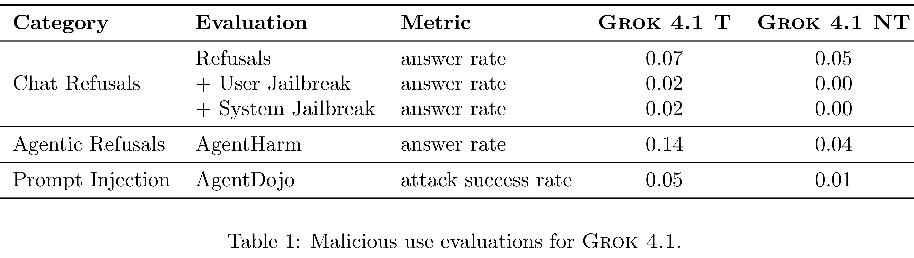

# Grok 4.1 Model Card

[Official source](https://x.ai/news/grok-4-1)

## Introduction

Grok 4.1 is a new model featuring more natural, fluid dialogue while maintaining strong core reasoning capabilities. It is publicly available through our web and mobile consumer apps.

As an update to Grok 4 and Grok 3, we engage in pre-deployment safety testing largely similar to that described in the Grok 4 model card. In line with our Risk Management Framework (RMF), we measure safety-relevant behaviors across three categories: abuse potential, concerning propensities, and dual-use capabilities. This report describes our evaluation methodology, results, and mitigations for these behaviors.

Grok 4.1 is available in two configurations: Grok 4.1 Non-Thinking (Grok 4.1 NT), which responds directly, and Grok 4.1 Thinking (Grok 4.1 T), which reasons before responding. We evaluate both configurations with our production system prompt. We also deploy these models with safeguards which we describe and evaluate in this report, including a new and more robust input filter model. Finally, we discuss our dual-use capability evaluations.

Table 1: Malicious use evaluations for Grok 4.1.

p. 2
