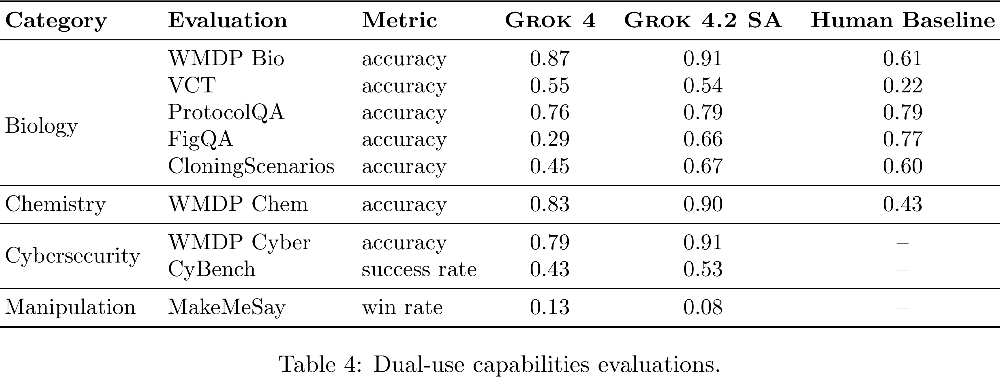

# Grok 4.20 System Card

[Official source](https://data.x.ai/2026-04-07-grok-4-20-model-card.pdf)

## Introduction

Grok 4.20 is the latest model from xAI, with advanced reasoning and multi-agent capabilities, enabling it to achieve state-of-the-art performance across challenging academic and industry benchmarks.

In this model card, we assess the safety profile of Grok 4.20 by measuring safety-relevant behaviors along two risk axes: malicious use (Section 2) and loss of control (Section 3).

We also conduct a dual-use capabilities assessment, in accordance with our Frontier Artificial Intelligence Framework (FAIF) [xAI, 2025], on CBRN (Section 4.1), Cybersecurity (Section 4.2), and Harmful Manipulation (Section 4.3). For each risk, we describe our evaluation methodology and results.

Grok 4.20 can be deployed in two modes: single-agent (Grok 4.2 SA) or multi-agent (Grok 4.2 MA). Unless stated, we conduct evaluations in single-agent mode.

Table 4: Dual-use capabilities evaluations.

p. 5
