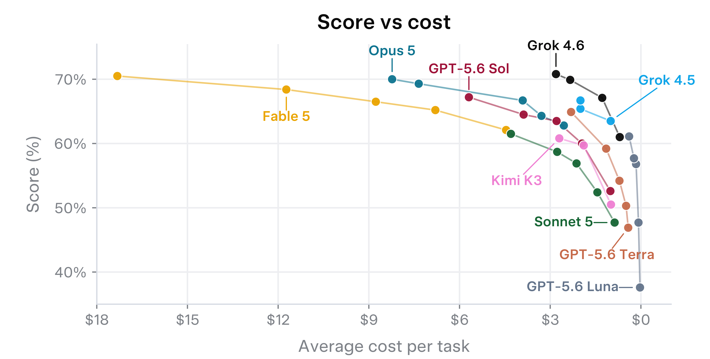

# Grok 4.6 Model Card

[Official source](https://x.ai/safety)

## 1.1 Overview

Grok 4.6 is capable of autonomously completing longer and more challenging tasks than any of our previous models, reaching results with fewer steps and fewer output tokens than other frontier models.

The primary purpose of this model card is to detail the capabilities of Grok 4.6 in quantitative and objective terms, to indicate where this model is most useful. We document safety domains (cyber, bio knowledge, bio agentic, jailbreaks/robustness, general output safety including CBRN refusals, mental health, and behaviors) and our safeguards below. Each evaluation under a capability or safety section has its own subsection. Unless stated otherwise, evaluation results are on the final deployed checkpoint of Grok 4.6.

We never silently downgrade intelligence or fall back to other models. Our goal is to preserve legitimate uses of the model: engineering and creative work, scientific research, hardening critical infrastructure, and AI research.

The model’s use is subject to SpaceXAI’s Acceptable Use Policy1, applicable Consumer and Enterprise Terms of Service, and any applicable laws. Grok 4.6 is not intended for autonomous high-stakes decision-making in domains such as medicine, law, finance, or safety-critical systems without appropriate human oversight and domain-expert validation.

Grok 4.6 is primarily a text model: it accepts natural-language text and images as input and produces text as output. It is available for use through the following channels:

• SpaceXAI API: Available from the console at console.x.ai; API users can call Grok 4.6

through the standard chat and completions endpoints.

• Grok Build: The default model in SpaceXAI’s terminal-based coding agent, available

through both the API and the CLI.

• Cursor: Available to all users, on every plan tier.

• Office add-ins: The default model in the Grok by SpaceXAI add-ins for Microsoft Word,

PowerPoint, and Excel.

• Model gateways: Reachable through OpenRouter, Vercel, Cloudflare, Snowflake,

Databricks Mosaic, and others.

SpaceXAI plans to add Grok 4.6 to its consumer surfaces (web, mobile apps, and Grok-in-X on the X platform) at a later date.

p. 9
