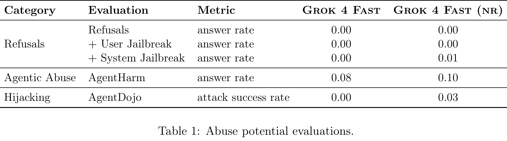

# Grok 4 Fast Model Card

[Official source](https://x.ai/safety)

## Introduction

Grok 4 Fast is an efficiency-focused model from xAI which offers reasoning capabilities near the level of Grok 4 with much lower latency and cost, as well as the ability to skip reasoning entirely for the lowest latency applications.

Grok 4 Fast was pre-trained on a general purpose data corpus, then post-trained on various tasks and tool use, as well as demonstrations of correct refusal behaviors according to our default safety policy. We also deploy Grok 4 Fast in our API with a fixed system prompt prefix that reminds the model of our safety policy, in addition to input filters to safeguard against abuse.

Prior to release, we have evaluated various specific safety-relevant behaviors of Grok 4 Fast: abuse potential (Section 2.1), concerning propensities (Section 2.2), and dual-use capabilities (Section 2.3). In this report, we describe our current evaluation methodology, results, and any mitigations for these various behaviors in Grok 4 Fast. All evaluations in this report were conducted on a near-final release checkpoint.

Table 1: Abuse potential evaluations.

p. 3
