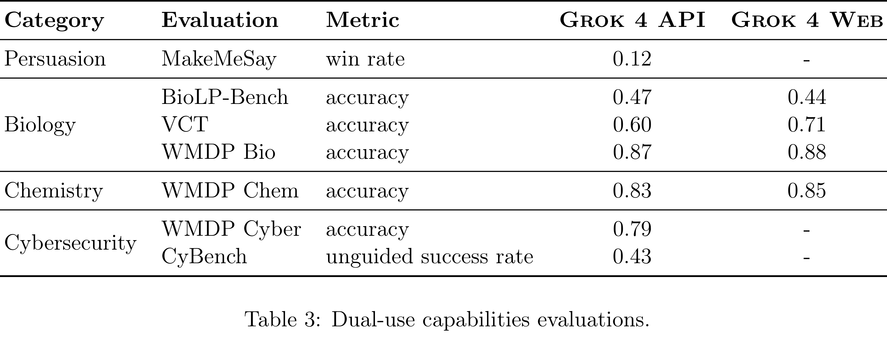

# Grok 4 Model Card

[Official source](https://x.ai/safety)

## Introduction

Grok 4 is the latest reasoning model from xAI with advanced reasoning and tool-use capabilities, enabling it to achieve new state-of-the-art performance across challenging academic and industry benchmarks. Because our models push the frontier of AI capabilities, we are committed to mitigating their risks through both evaluating model behaviors and implementing safeguards.

Following our Risk Management Framework (RMF), we aim to reduce the risk of severe, large-scale harms to people, property, and society from AI. The two primary categories of risk we consider are risks from either malicious use or loss of control. Different risk scenarios within these categories involve different model behaviors. For example, a hypothetical terrorist group using AI to help synthesize chemical weapons would require models that possess advanced scientific knowledge, whereas a hypothetical rogue AI exfiltrating its weights requires models that can manipulate humans and hack systems.

Our approach to safety evaluations focuses on measuring specific safety-relevant behaviors relevant to different risk scenarios. We categorize these safety-relevant behaviors as: abuse potential (Section 2.1), concerning propensities (Section 2.2), and dual-use capabilities (Section 2.3). This report describes our current evaluation methodology, results, and mitigations for these various behaviors.

In this document, we focus on the Grok 4 model. xAI deploys Grok 4 in both the consumer-facing applications (Grok 4 Web) and through an enterprise use-focused API (Grok 4 API). We report evaluations for Grok 4 API and Grok 4 Web now available to our customers, including in the EU. Finally, we describe our training pipeline (Section 3.1) and additional transparency commitments (Section 3.2).

Table 3: Dual-use capabilities evaluations.

p. 6
