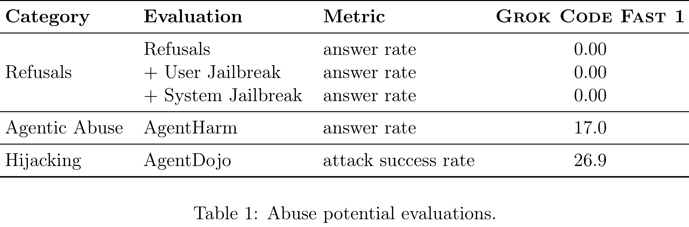

# Grok Code Fast 1 Model Card

[Official source](https://x.ai/safety)

## Introduction

Grok Code Fast 1 is a fast and efficient reasoning model from xAI designed for coding applications using agentic harnesses. An “agentic harness” is a program which manages the context window for the underlying AI model and passes information between the user, the model, and any tools used by the model (e.g. navigating between directories, reading and editing files, executing code). Grok Code Fast 1 interacts with the user and project workspace through the same conversational assistant paradigm as Grok 4, where it is able to iteratively call tools and read tool outputs to complete user-specified tasks.

Grok Code Fast 1 was pre-trained on a coding-focused data mixture, then post-trained on demonstrations of various coding tasks and tool use in different agentic harnesses, as well as demonstrations of correct refusal behaviors according to our default safety policy. We also deploy Grok Code Fast 1 with a fixed system prompt prefix that reminds the model of our safety policy.

Prior to release, we have evaluated various specific safety-relevant behaviors of Grok Code Fast 1: abuse potential (Section 2.1), concerning propensities (Section 2.2), and dual-use capabilities (Section 2.3). In this report, we describe our current evaluation methodology, results, and any mitigations for these various behaviors on Grok Code Fast 1, which is available to end users via third-party partners and through the enterprise-focused xAI API. Abuse potential and concerning propensities evaluations were conducted on the final release checkpoint, and dual-use capabilities evaluations were conducted on a near-release checkpoint.

Table 1: Abuse potential evaluations.

p. 3
