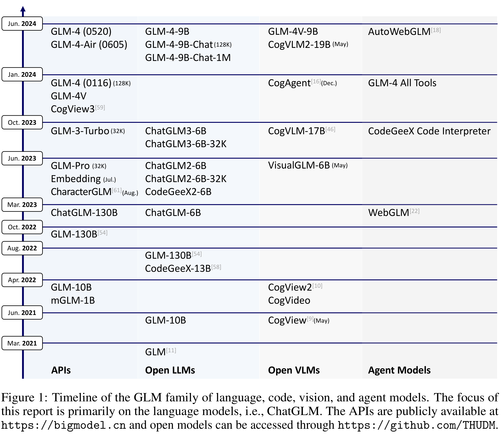

# ChatGLM: A Family of Large Language Models from GLM-130B to GLM-4 All Tools

[Official source](https://github.com/zai-org/GLM-4)

## Abstract

We introduce ChatGLM, an evolving family of large language models that we have been developing over time. This report primarily focuses on the GLM-4 language series, which includes GLM-4, GLM-4-Air, and GLM-4-9B. They represent our most capable models that are trained with all the insights and lessons gained from the preceding three generations of ChatGLM. To date, the GLM-4 models are pre-trained on ten trillions of tokens mostly in Chinese and English, along with a small set of corpus from 24 languages, and aligned primarily for Chinese and English usage. The high-quality alignment is achieved via a multi-stage post-training process, which involves supervised fine-tuning and learning from human feedback. Evaluations show that GLM-4, 1) closely rivals or outperforms GPT-4 in terms of general metrics such as MMLU, GSM8K, MATH, BBH, GPQA, and HumanEval, 2) gets close to GPT-4-Turbo in instruction following as measured by IFEval, 3) matches GPT-4 Turbo (128K) and Claude 3 for long context tasks, and 4) outperforms GPT-4 in Chinese alignments as measured by AlignBench. The GLM-4 All Tools model is further aligned to understand user intent and autonomously decide when and which tool(s) to use—including web browser, Python interpreter, text-to-image model, and user-defined functions—to effectively complete complex tasks. In practical applications, it matches and even surpasses GPT-4 All Tools in tasks like accessing online information via web browsing and solving math problems using Python interpreter. Over the course, we have open-sourced a series of models, including ChatGLM-6B (three generations), GLM-4-9B (128K, 1M), GLM-4V-9B, WebGLM, and CodeGeeX, attracting over 10 million downloads on Hugging face in the year 2023 alone. The open models can be accessed through https://github.com/THUDM and https://huggingface.co/THUDM.

Figure 1: Timeline of the GLM family of language, code, vision, and agent models. The focus of this report is primarily on the language models, i.e., ChatGLM. The APIs are publicly available at https://bigmodel.cn and open models can be accessed through https://github.com/THUDM.

p. 2
