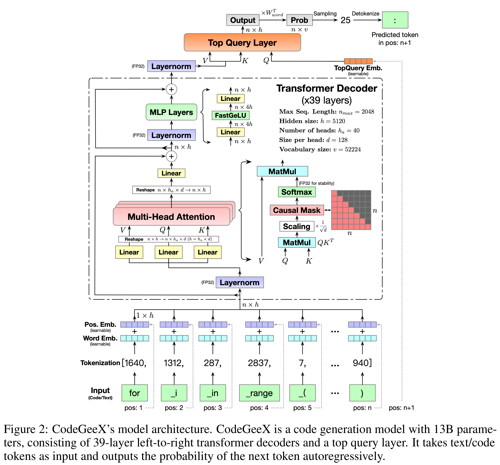

# CodeGeeX: A Pre-Trained Model for Code Generation with Multilingual Benchmarking on HumanEval-X

[Official source](https://github.com/zai-org/CodeGeeX)

## Abstract

Large pre-trained code generation models, such as OpenAI Codex, can generate syntax- and function-correct code, making the coding of programmers more productive and our pursuit of artificial general intelligence closer. In this paper, we introduce CodeGeeX, a multilingual model with 13 billion parameters for code generation. CodeGeeX is pre-trained on 850 billion tokens of 23 programming languages as of June 2022. Our extensive experiments suggest that CodeGeeX outperforms multilingual code models of similar scale for both the tasks of code generation and translation on HumanEval-X. Building upon HumanEval (Python only), we develop the HumanEval-X benchmark for evaluating multilingual models by hand-writing the solutions in C++, Java, JavaScript, and Go. In addition, we build CodeGeeX-based extensions on Visual Studio Code, JetBrains, and Cloud Studio, generating 4.7 billion tokens for tens of thousands of active users per week. Our user study demonstrates that CodeGeeX can help to increase coding efficiency for 83.4% of its users. Finally, CodeGeeX is publicly accessible and in Sep. 2022, we open-sourced its code, model weights (the version of 850B tokens), API, extensions, and HumanEval-X at https://github.com/THUDM/CodeGeeX.

Figure 2: CodeGeeX’s model architecture. CodeGeeX is a code generation model with 13B parameters, consisting of 39-layer left-to-right transformer decoders and a top query layer. It takes text/code tokens as input and outputs the probability of the next token autoregressively.

p. 4
