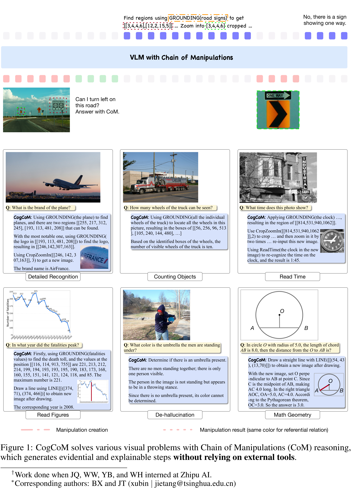

# CogCoM: A Visual Language Model with Chain-of-Manipulations Reasoning

[Official source](https://arxiv.org/abs/2402.04236)

## ABSTRACT

Vision-Language Models (VLMs) have shown broad effectiveness due to extensive training that aligns visual inputs with corresponding language responses. However, this conclusive alignment training causes models to overlook essential visual reasoning, leading to failures in handling detailed visual tasks and producing unfaithful responses. Drawing inspiration from human cognition in solving visual problems (e.g., marking, zoom in), this paper introduces Chain of Manipulations, a mechanism that enables VLMs to tackle problems step-by-step with evidence. After training, models can solve various visual problems by eliciting intrinsic manipulations (e.g., grounding, zoom in) with results (e.g., boxes, image) actively without relying on external tools, while also allowing users to trace error causes. In this paper, we study the comprehensive methodology that includes: (1) a flexible design of manipulations based on extensive analysis, (2) an efficient automated data generation pipeline, (3) a compatible VLM architecture capable of multi-turn, multi-image, and (4) a model training process for versatile capabilities. With the design, we also manually annotate 6K high-quality samples for challenging graphical mathematical problems. Our trained model, CogCoM, equipped with this mechanism and 17B parameters, achieves SOTA performance across 9 benchmarks in 4 categories, demonstrating its effectiveness while maintaining interpretability. Code, model, and data are available at https://github.com/THUDM/CogCoM.

Figure 1: CogCoM solves various visual problems with Chain of Manipulations (CoM) reasoning, which generates evidential and explainable steps without relying on external tools.

p. 1
