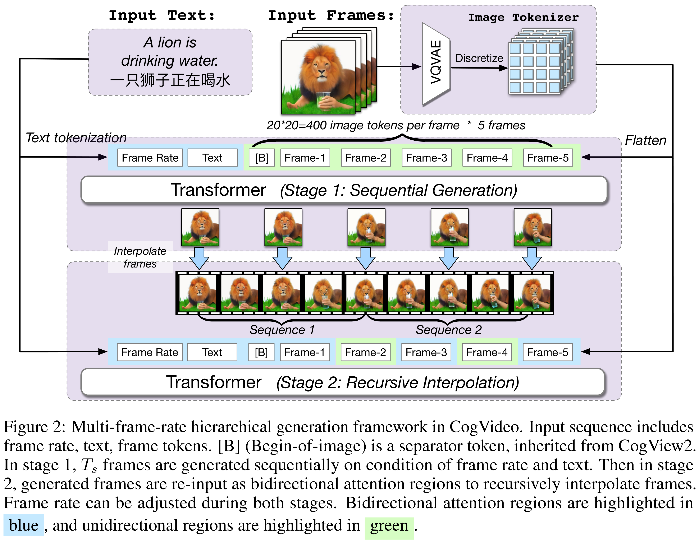

# CogVideo: Large-scale Pretraining for Text-to-Video Generation via Transformers

[Official source](https://github.com/zai-org/CogVideo)

## Abstract

Large-scale pretrained transformers have created milestones in text (GPT-3) and text-to-image (DALL-E and CogView) generation. Its application to video generation is still facing many challenges: The potential huge computation cost makes the training from scratch unaffordable; The scarcity and weak relevance of text-video datasets hinder the model understanding complex movement semantics. In this work, we present 9B-parameter transformer CogVideo, trained by inheriting a pretrained text-to-image model, CogView2. We also propose multi-frame-rate hierarchical training strategy to better align text and video clips. As (probably) the first open-source large-scale pretrained text-to-video model, CogVideo outperforms all publicly available models at a large margin in machine and human evaluations.

Figure 2: Multi-frame-rate hierarchical generation framework in CogVideo. Input sequence includes frame rate, text, frame tokens. [B] (Begin-of-image) is a separator token, inherited from CogView2. In stage 1, Ts frames are generated sequentially on condition of frame rate and text. Then in stage 2, generated frames are re-input as bidirectional attention regions to recursively interpolate frames. Frame rate can be adjusted during both stages. Bidirectional attention regions are highlighted in

p. 4
