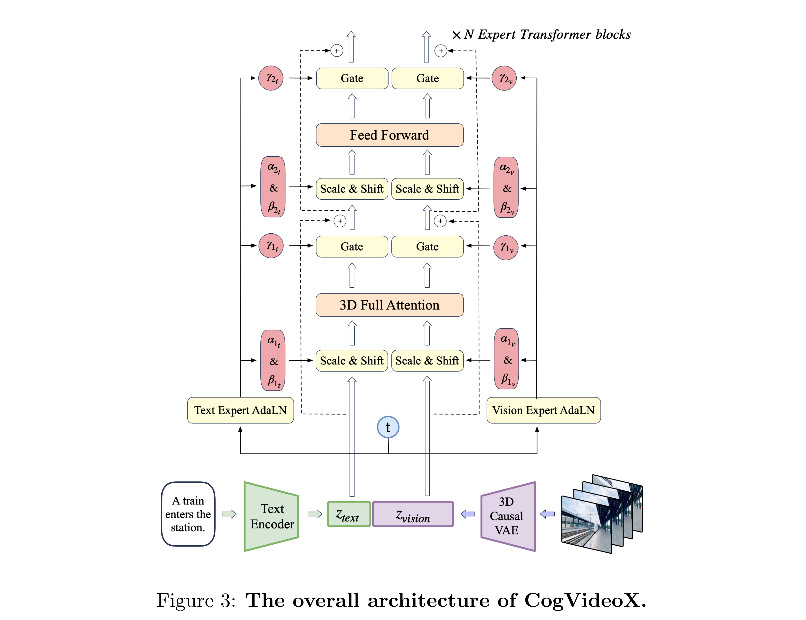

# CogVideoX: Text-to-Video Diffusion Models with An Expert Transformer

[Official source](https://github.com/zai-org/CogVideo)

## Abstract

We present CogVideoX, a large-scale text-to-video generation model based on diffusion transformer, which can generate 10-second continuous videos that align seamlessly with text prompts, with a frame rate of 16 fps and resolution of 768 × 1360 pixels. Previous video generation models often struggled with limited motion and short durations. It is especially difficult to generate videos with coherent narratives based on text. We propose several designs to address these issues. First, we introduce a 3D Variational Autoencoder (VAE) to compress videos across spatial and temporal dimensions, enhancing both the compression rate and video fidelity. Second, to improve text-video alignment, we propose an expert transformer with expert adaptive LayerNorm to facilitate the deep fusion between the two modalities. Third, by employing progressive training and multi-resolution frame packing, CogVideoX excels at generating coherent, long-duration videos with diverse shapes and dynamic movements. In addition, we develop an effective pipeline that includes various pre-processing strategies for text and video data. Our innovative video captioning model significantly improves generation quality and semantic alignment. Results show that CogVideoX achieves state-of-the-art performance in both automated benchmarks and human evaluation. We publish the code and model checkpoints of CogVideoX along with our VAE model and video captioning model at https://github.com/THUDM/CogVideo.

Figure 3: The overall architecture of CogVideoX.

p. 3
