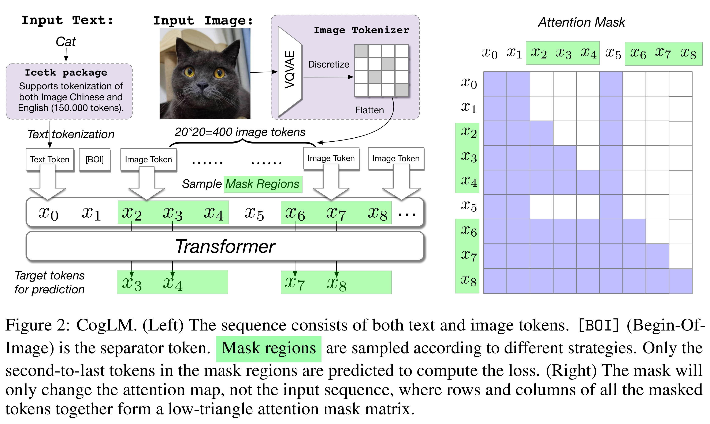

# CogView2: Faster and Better Text-to-Image Generation via Hierarchical Transformers

[Official source](https://github.com/zai-org/CogView2)

## Abstract

Development of transformer-based text-to-image models is impeded by its slow generation and complexity, for high-resolution images. In this work, we put forward a solution based on hierarchical transformers and local parallel autoregressive generation. We pretrain a 6B-parameter transformer with a simple and flexible self-supervised task, a cross-modal general language model (CogLM), and fine-tune it for fast super-resolution. The new text-to-image system, CogView2, shows competitive generation performance to the concurrent state-of-the-art DALL-E-2, and naturally supports interactive text-guided editing on images.

Figure 2: CogLM. (Left) The sequence consists of both text and image tokens. [BOI] (Begin-Of-Image) is the separator token. Mask regions are sampled according to different strategies. Only the second-to-last tokens in the mask regions are predicted to compute the loss. (Right) The mask will only change the attention map, not the input sequence, where rows and columns of all the masked tokens together form a low-triangle attention mask matrix.

p. 3
