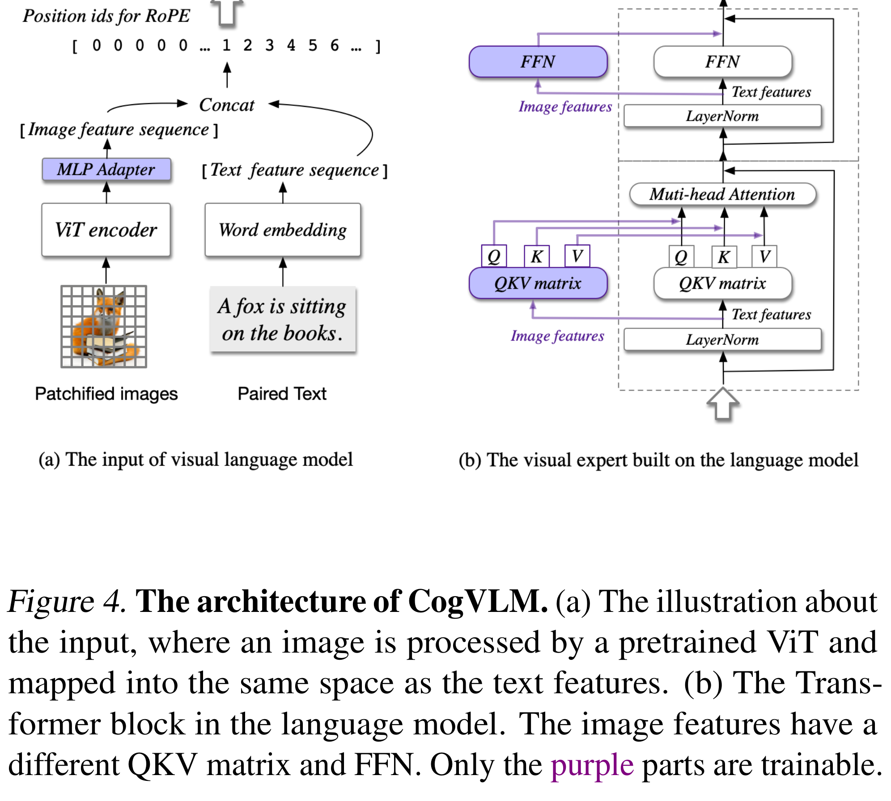

# CogVLM: Visual Expert for Pretrained Language Models

[Official source](https://github.com/zai-org/CogVLM)

## Abstract

We introduce CogVLM, a powerful open-source visual language foundation model. Different from the popular shallow alignment method which maps image features into the input space of language model, CogVLM bridges the gap between the frozen pretrained language model and image encoder by a trainable visual expert module in the attention and FFN layers. As a result, CogVLM enables a deep fusion of vision language features without sacrificing any performance on NLP tasks. CogVLM-17B achieves state-of-the-art performance on 17 classic cross-modal benchmarks, including 1) image captioning datasets: NoCaps, Flicker30k, 2) VQA datasets: OKVQA, TextVQA, OCRVQA, ScienceQA, 3) LVLM benchmarks: MM-Vet, MMBench, SEED-Bench, LLaVABench, POPE, MMMU, MathVista, 4) visual grounding datasets: RefCOCO, RefCOCO+, RefCOCOg, Visual7W. Codes and checkpoints are available at https://github.com/THUDM/CogVLM.

Figure 4. The architecture of CogVLM. (a) The illustration about

p. 3
