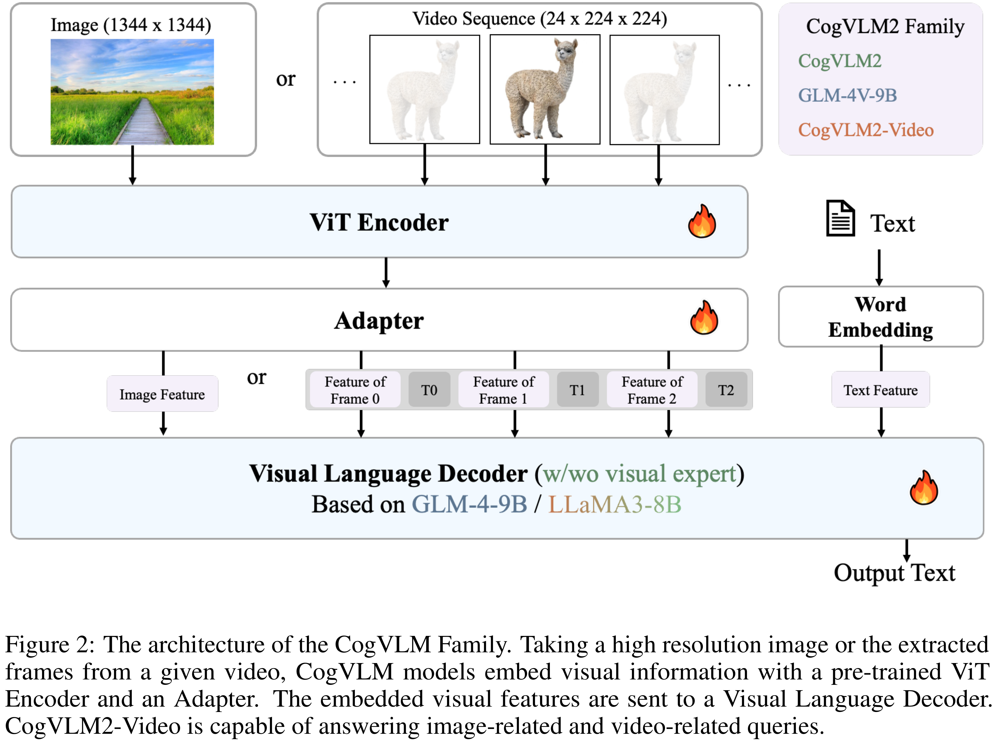

# CogVLM2: Visual Language Models for Image and Video Understanding

[Official source](https://github.com/zai-org/CogVLM2)

## Abstract

Beginning with VisualGLM and CogVLM, we are continuously exploring VLMs in pursuit of enhanced vision-language fusion, efficient higher-resolution architecture, and broader modalities and applications. Here we propose the CogVLM2 family, a new generation of visual language models for image and video understanding including CogVLM2, CogVLM2-Video and GLM-4V. As an image understanding model, CogVLM2 inherits the visual expert architecture with improved training recipes in both pre-training and post-training stages, supporting input resolution up to 1344 × 1344 pixels. As a video understanding model, CogVLM2-Video integrates multi-frame input with timestamps and proposes automated temporal grounding data construction. Notably, CogVLM2 family has achieved state-of-the-art results on benchmarks like MMBench, MM-Vet, TextVQA, MVBench and VCG-Bench. All models are open-sourced in https://github.com/THUDM/CogVLM2 and https://github.com/THUDM/GLM-4, contributing to the advancement of the field.

Figure 2: The architecture of the CogVLM Family. Taking a high resolution image or the extracted frames from a given video, CogVLM models embed visual information with a pre-trained ViT Encoder and an Adapter. The embedded visual features are sent to a Visual Language Decoder. CogVLM2-Video is capable of answering image-related and video-related queries.

p. 5
