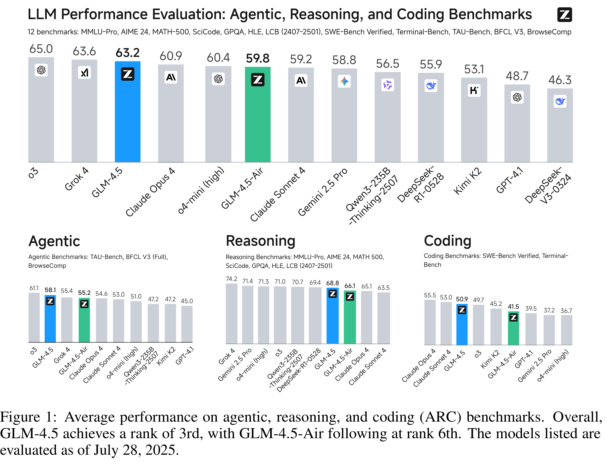

# GLM-4.5: Agentic, Reasoning, and Coding (ARC) Foundation Models

[Official source](https://github.com/zai-org/GLM-4.5)

## Abstract

We present GLM-4.5, an open-source Mixture-of-Experts (MoE) large language model with 355B total parameters and 32B activated parameters, featuring a hybrid reasoning method that supports both thinking and direct response modes. Through multi-stage training on 23T tokens and comprehensive post-training with expert model iteration and reinforcement learning, GLM-4.5 achieves strong performance across agentic, reasoning, and coding (ARC) tasks, scoring 70.1% on TAU-Bench, 91.0% on AIME 24, and 64.2% on SWE-bench Verified. With much fewer parameters than several competitors, GLM-4.5 ranks 3rd overall among all evaluated models and 2nd on agentic benchmarks. We release both GLM-4.5 (355B parameters) and a compact version, GLM-4.5-Air (106B parameters), to advance research in reasoning and agentic AI systems. Code, models, and more information are available at https://github.com/zai-org/GLM-4.5.

Figure 1: Average performance on agentic, reasoning, and coding (ARC) benchmarks. Overall, GLM-4.5 achieves a rank of 3rd, with GLM-4.5-Air following at rank 6th. The models listed are evaluated as of July 28, 2025.

p. 1
