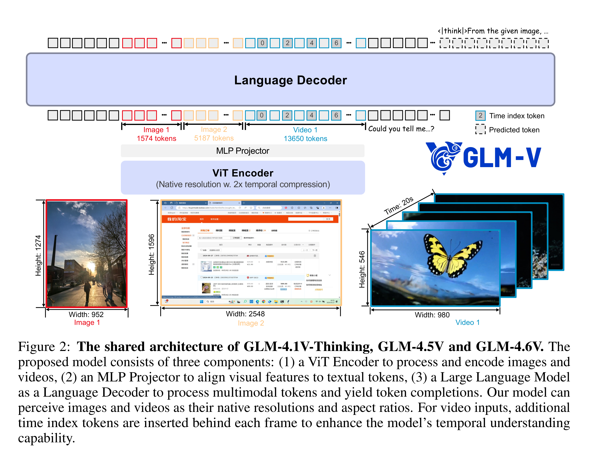

# GLM-4.5V and GLM-4.1V-Thinking: Towards Versatile Multimodal Reasoning with Scalable Reinforcement Learning

[Official source](https://github.com/zai-org/GLM-V)

## Abstract

We present GLM-4.1V-Thinking, GLM-4.5V, and GLM-4.6V, a family of vision-language models (VLMs) designed to advance general-purpose multimodal understanding and reasoning. In this report, we share our key findings in the development of the reasoning-centric training framework. We first develop a capable vision foundation model with significant potential through large-scale pre-training, which arguably sets the upper bound for the final performance. We then propose Reinforcement Learning with Curriculum Sampling (RLCS) to unlock the full potential of the model, leading to comprehensive capability enhancement across a diverse range of tasks, including STEM problem solving, video understanding, content recognition, coding, grounding, GUI-based agents, and long document interpretation. In a comprehensive evaluation across 42 public benchmarks, GLM-4.5V achieves state-of-the-art performance on nearly all tasks among open-source models of similar size, and demonstrates competitive or even superior results compared to closed-source models such as Gemini-2.5-Flash on challenging tasks including Coding and GUI Agents. Meanwhile, the smaller GLM-4.1V-9B-Thinking remains highly competitive—achieving superior results to the much larger Qwen2.5-VL-72B on 29 benchmarks. We open-source both GLM-4.1V-9B-Thinking and GLM-4.5V. We further introduce the GLM-4.6V series, open-source multimodal models with native tool use and a 128K context window. A brief overview is available at https://z.ai/blog/glm-4.6v. Code, models and more information are released at https://github.com/zai-org/GLM-V.

Figure 2: The shared architecture of GLM-4.1V-Thinking, GLM-4.5V and GLM-4.6V. The proposed model consists of three components: (1) a ViT Encoder to process and encode images and videos, (2) an MLP Projector to align visual features to textual tokens, (3) a Large Language Model as a Language Decoder to process multimodal tokens and yield token completions. Our model can perceive images and videos as their native resolutions and aspect ratios. For video inputs, additional time index tokens are inserted behind each frame to enhance the model’s temporal understanding capability.

p. 4
