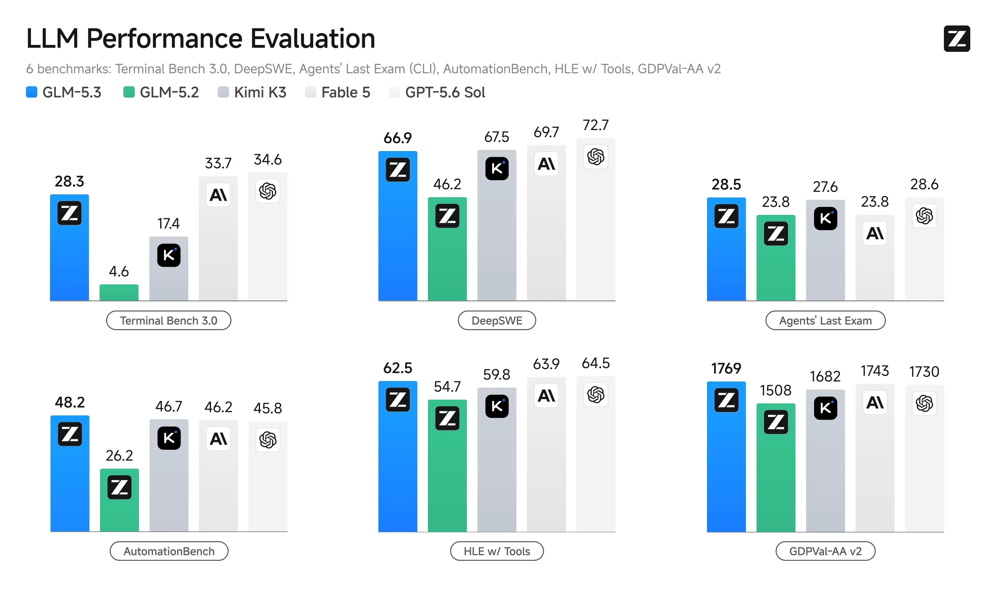

# GLM-5.3

[Official source](https://huggingface.co/zai-org/GLM-5.3)

GLM-5.3 uses the same base model as GLM-5.2 — every gain comes from post-training. Compared with GLM-5.2, it is much better at complex coding and long-horizon tasks:

Stronger Coding: GLM-5.3 is the most capable open-weights model for coding, with a 50% improvement over GLM-5.2 on our in-house Z.ai Code Bench. It also achieve open-source SOTA on public benchmarks including Terminal Bench 3.0 and Agents' Last Exam.

Emergent Cyber Capability: As we scaled post-training, cyber capability developed faster than we expected. GLM-5.3 is state of the art on CyberGym for vulnerability discovery, and its gains are largest further up the exploitation chain, where it more than doubles GLM-5.2 on exploitation benchmarks.

