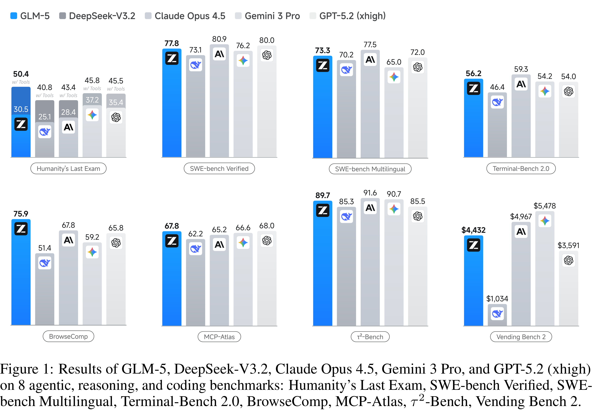

# GLM-5: from Vibe Coding to Agentic Engineering

[Official source](https://github.com/zai-org/GLM-5)

## Abstract

We present GLM-5, a next-generation foundation model designed to transition the paradigm of vibe coding to agentic engineering. Building upon the agentic, reasoning, and coding (ARC) capabilities of its predecessor, GLM-5 adopts DSA to significantly reduce training and inference costs while maintaining long-context fidelity. To advance model alignment and autonomy, we implement a new asynchronous reinforcement learning infrastructure that drastically improves post-training efficiency by decoupling generation from training. Furthermore, we propose novel asynchronous agent RL algorithms that further improve RL quality, enabling the model to learn from complex, long-horizon interactions more effectively. Through these innovations, GLM-5 achieves state-of-the-art performance on major open benchmarks. Most critically, GLM-5 demonstrates unprecedented capability in real-world coding tasks, surpassing previous baselines in handling end-to-end software engineering challenges. Code, models, and more information are available at https://github.com/zai-org/GLM-5.

Figure 1: Results of GLM-5, DeepSeek-V3.2, Claude Opus 4.5, Gemini 3 Pro, and GPT-5.2 (xhigh) on 8 agentic, reasoning, and coding benchmarks: Humanity’s Last Exam, SWE-bench Verified, SWE-bench Multilingual, Terminal-Bench 2.0, BrowseComp, MCP-Atlas, τ²-Bench, Vending Bench 2.

p. 1
