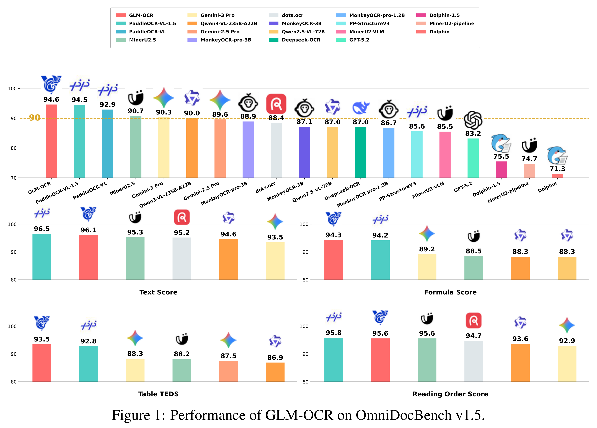
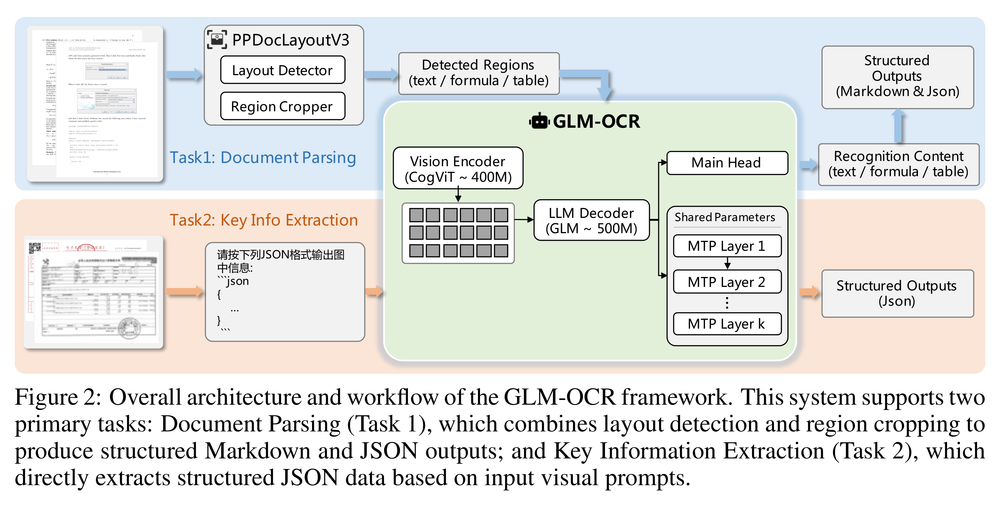

# GLM-OCR Technical Report

[Official source](https://github.com/zai-org/GLM-OCR)

## ABSTRACT

GLM-OCR is an efficient 0.9B-parameter compact multimodal model designed for real-world document understanding. It combines a 0.4B-parameter CogViT visual encoder with a 0.5B-parameter GLM language decoder, achieving a strong balance between computational efficiency and recognition performance. To ad- dress the inefficiency of standard autoregressive decoding in deterministic OCR tasks, GLM-OCR introduces a Multi-Token Prediction (MTP) mechanism that predicts multiple tokens per step, significantly improving decoding throughput while keeping memory overhead low through shared parameters. At the system level, a two-stage pipeline is adopted: PP-DocLayout-V3 first performs layout analysis, followed by parallel region-level recognition. Extensive evaluations on public benchmarks and industrial scenarios show that GLM-OCR achieves com- petitive or state-of-the-art performance in document parsing, text and formula transcription, table structure recovery, and key information extraction. Its com- pact architecture and structured generation make it suitable for both resource- constrained edge deployment and large-scale production systems.

Figure 1: Performance of GLM-OCR on OmniDocBench v1.5.

p. 1

Figure 2: Overall architecture and workflow of the GLM-OCR framework. This system supports two primary tasks: Document Parsing (Task 1), which combines layout detection and region cropping to produce structured Markdown and JSON outputs; and Key Information Extraction (Task 2), which directly extracts structured JSON data based on input visual prompts.

p. 4
