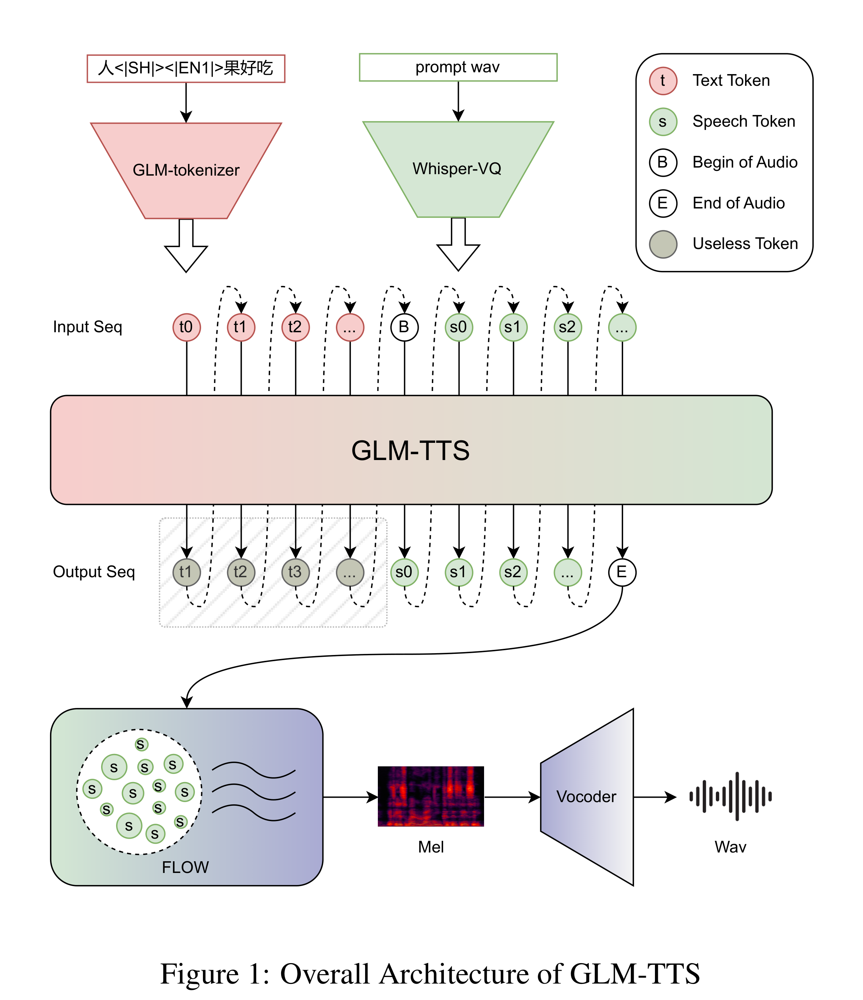
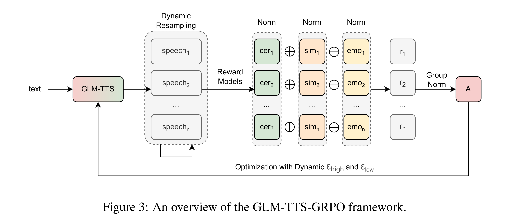

# GLM-TTS Technical Report

[Official source](https://github.com/zai-org/GLM-TTS)

## ABSTRACT

This work proposes GLM-TTS, a production-level TTS system designed for ef- ficiency, controllability, and high-fidelity speech generation. GLM-TTS follows a two-stage architecture, consisting of a text-to-token autoregressive model and a token-to-waveform diffusion model. With only 100k hours of training data, GLM- TTS achieves state-of-the-art performance on multiple open-source benchmarks. To meet production requirements, GLM-TTS improves speech quality through an optimized speech tokenizer with fundamental frequency constraints and a GRPO- based multi-reward reinforcement learning framework that jointly optimizes pro- nunciation, speaker similarity, and expressive prosody. In parallel, the system en- ables efficient and controllable deployment via parameter-efficient LoRA-based voice customization and a hybrid phoneme–text input scheme that provides pre- cise pronunciation control. Our code is available at https://github.com/ zai-org/GLM-TTS. Real-time speech synthesis demos are provided via Z.ai (audio.z.ai), the Zhipu Qingyan app/web (chatglm.cn).

Figure 1: Overall Architecture of GLM-TTS

p. 1

Figure 3: An overview of the GLM-TTS-GRPO framework.

p. 5
