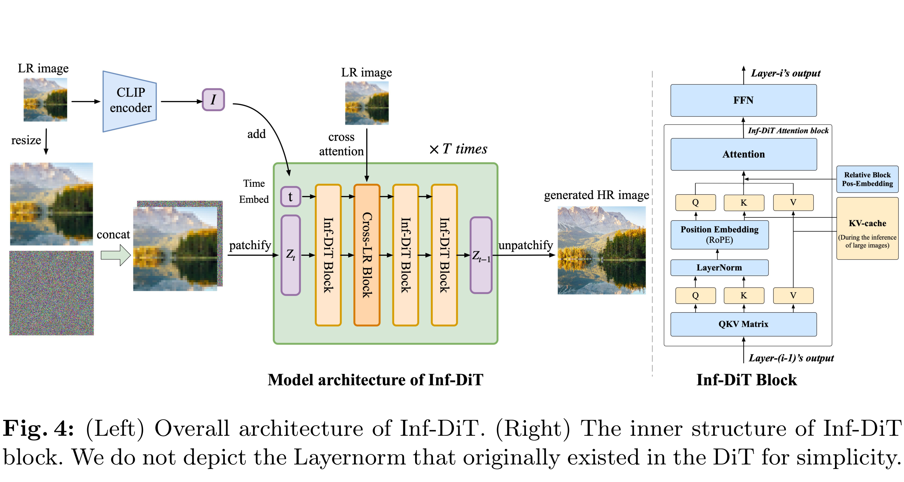

# Inf-DiT: Upsampling Any-Resolution Image with Memory-Efficient Diffusion Transformer

[Official source](https://arxiv.org/abs/2405.04312)

## Abstract.

Diffusion models have shown remarkable performance in image generation in recent years. However, due to a quadratic increase in memory during generating ultra-high-resolution images (e.g. 4096 × 4096), the resolution of generated images is often limited to 1024 × 1024. In this work. we propose a unidirectional block attention mechanism that can adaptively adjust the memory overhead during the inference process and handle global dependencies. Building on this module, we adopt the DiT structure for upsampling and develop an infinite super-resolution model capable of upsampling images of various shapes and resolutions. Comprehensive experiments show that our model achieves SOTA performance in generating ultra-high-resolution images in both machine and

⋆ Done as intern at Zhipu AI, yangzy22@mails.tsinghua.edu.cn ⋆⋆ Corresponding author jietang@tsinghua.edu.cn

Yang et al.

human evaluation. Compared to commonly used UNet structures, our model can save more than 5× memory when generating 4096 × 4096 images. The project URL is https://github.com/THUDM/Inf-DiT.

Keywords: diffusion model · ultra-high-resolution generation · super-resolution

Fig. 4: (Left) Overall architecture of Inf-DiT. (Right) The inner structure of Inf-DiT block. We do not depict the Layernorm that originally existed in the DiT for simplicity.

p. 6
