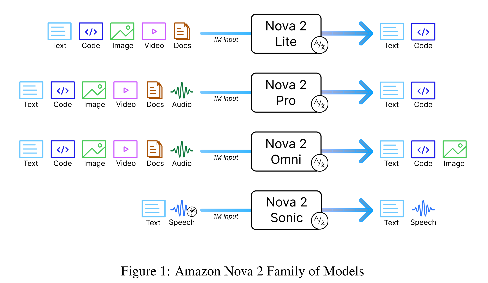
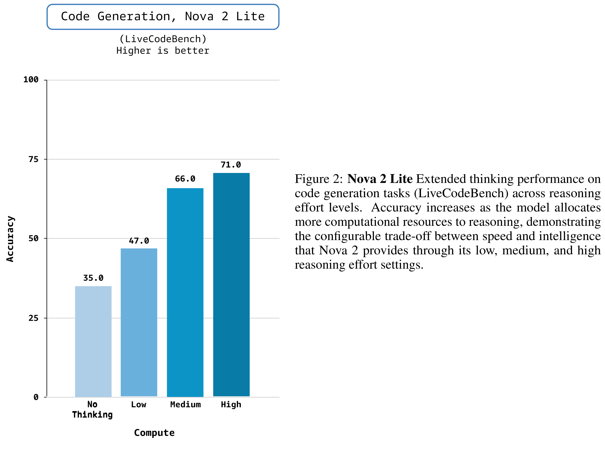

# Amazon Nova 2: Multimodal Reasoning and Generation Models

[中文](README_CN.md) · [Core figures](../../README.md)

[Original PDF](../../../pdfs/amazon/technical-reports/nova-2-family.pdf) · [Official source](https://www.amazon.science/publications/amazon-nova-2-multimodal-reasoning-and-generation-models)

## Overview · Figure 1

Source page: 1 · [PNG](figure-01.png) · [PDF with original graphics](figure-01.pdf)

[View source page](../../../pdfs/amazon/technical-reports/nova-2-family.pdf#page=1)

Figure 1: Amazon Nova 2 Family of Models

## Results · Figure 2

Source page: 3 · [PNG](figure-02.png) · [PDF with original graphics](figure-02.pdf)

[View source page](../../../pdfs/amazon/technical-reports/nova-2-family.pdf#page=3)

Figure 2: Nova 2 Lite Extended thinking performance on
code generation tasks (LiveCodeBench) across reasoning
effort levels. Accuracy increases as the model allocates
more computational resources to reasoning, demonstrating
the configurable trade-off between speed and intelligence
that Nova 2 provides through its low, medium, and high
reasoning effort settings.
