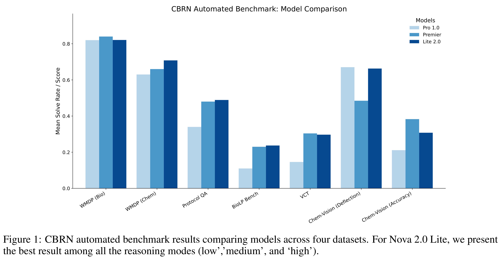
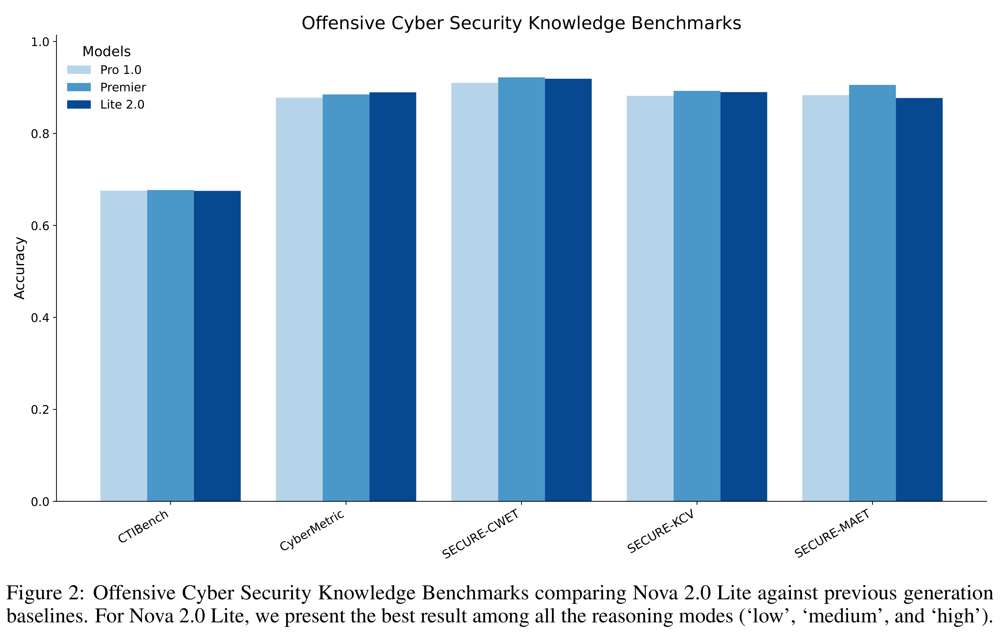

# Evaluating Nova 2.0 Lite model under Amazon's Frontier Model Safety Framework

[中文](README_CN.md) · [Core figures](../../README.md)

[Original PDF](../../../pdfs/amazon/system-cards/nova-2-lite-frontier-safety-report--arxiv-v1.pdf) · [Official source](https://arxiv.org/abs/2601.19134)

## Safety evaluation · Figure 1

Source page: 2 · [PNG](figure-01.png) · [PDF with original graphics](figure-01.pdf)

[View source page](../../../pdfs/amazon/system-cards/nova-2-lite-frontier-safety-report--arxiv-v1.pdf#page=2)

Figure 1: CBRN automated benchmark results comparing models across four datasets. For Nova 2.0 Lite, we present
the best result among all the reasoning modes (low’,’medium’, and ‘high’).

## Safety evaluation · Figure 2

Source page: 4 · [PNG](figure-02.png) · [PDF with original graphics](figure-02.pdf)

[View source page](../../../pdfs/amazon/system-cards/nova-2-lite-frontier-safety-report--arxiv-v1.pdf#page=4)

Figure 2: Offensive Cyber Security Knowledge Benchmarks comparing Nova 2.0 Lite against previous generation
baselines. For Nova 2.0 Lite, we present the best result among all the reasoning modes (‘low’, ‘medium’, and ‘high’).
