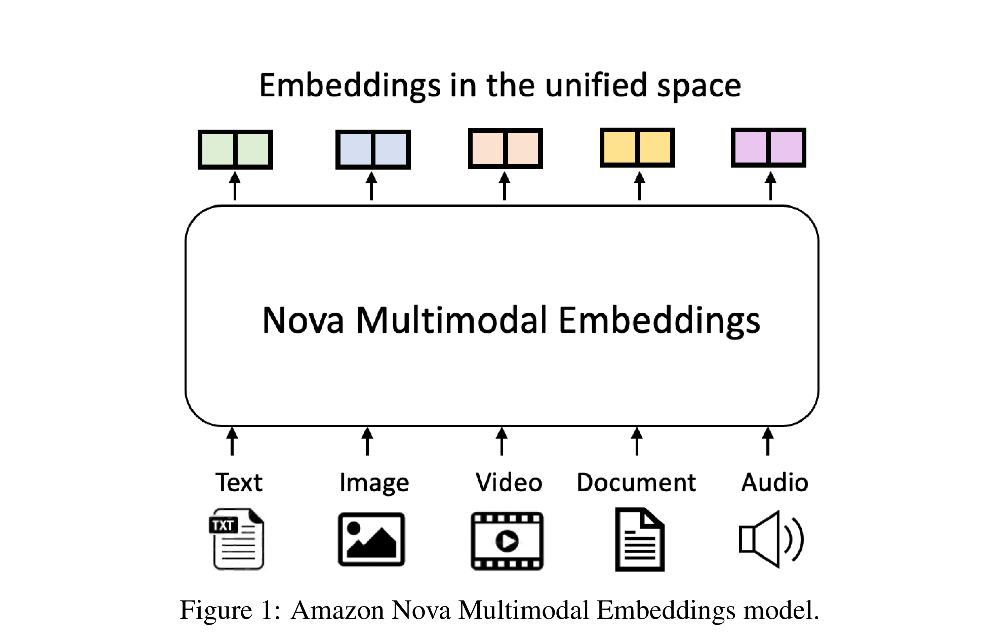

# Amazon Nova Multimodal Embeddings: Technical Report and Model Card

[English](README.md) · [核心图片](../../README_CN.md)

[原始 PDF](../../../pdfs/amazon/technical-reports/nova-multimodal-embeddings.pdf) · [官方来源](https://www.amazon.science/publications/amazon-nova-multimodal-embeddings-technical-report-and-model-card)

## 架构 · Figure 1

原文第1页 · [PNG](figure-01.png) · [保留原始图形的 PDF](figure-01.pdf)

[查看原页](../../../pdfs/amazon/technical-reports/nova-multimodal-embeddings.pdf#page=1)

Figure 1: Amazon Nova Multimodal Embeddings model.
