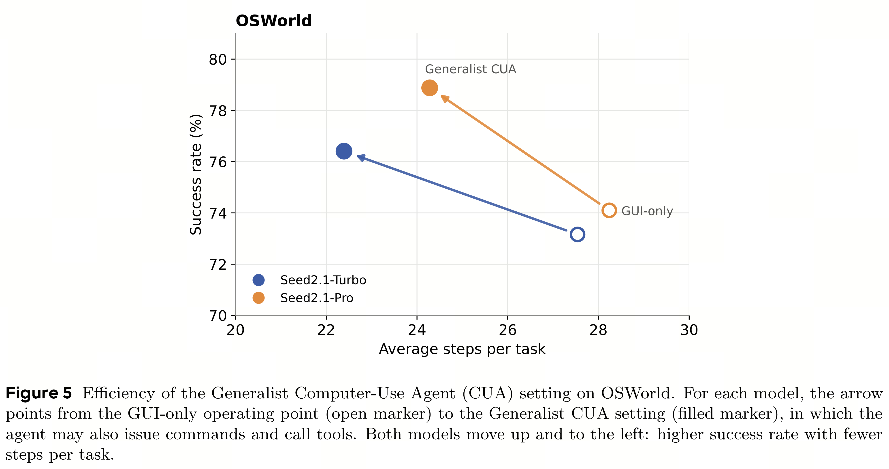
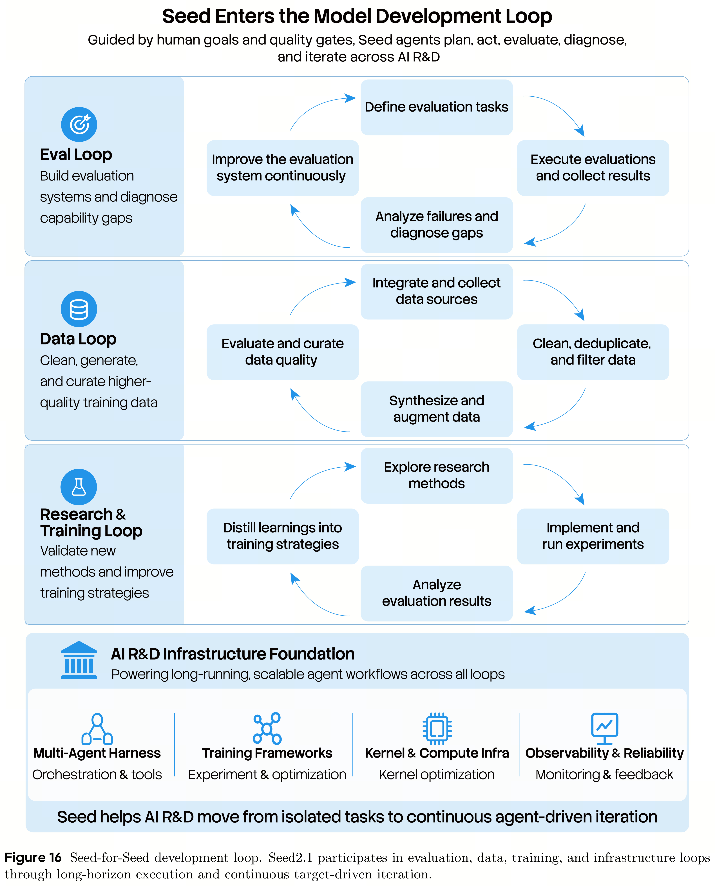

# Seed2.1 Model Card: Agentic Intelligence for Productivity

[中文](README_CN.md) · [Core figures](../../README.md)

[Original PDF](../../../pdfs/bytedance/model-cards/seed2-1-model-card.pdf) · [Official source](https://seed.bytedance.com/en/seed_model_portfolio)

## Results · Figure 5

Source page: 13 · [PNG](figure-01.png) · [PDF with original graphics](figure-01.pdf)

[View source page](../../../pdfs/bytedance/model-cards/seed2-1-model-card.pdf#page=13)

Figure 5 Efficiency of the Generalist Computer-Use Agent (CUA) setting on OSWorld. For each model, the arrow
points from the GUI-only operating point (open marker) to the Generalist CUA setting (filled marker), in which the
agent may also issue commands and call tools. Both models move up and to the left: higher success rate with fewer
steps per task.

## Overview · Figure 16

Source page: 28 · [PNG](figure-02.png) · [PDF with original graphics](figure-02.pdf)

[View source page](../../../pdfs/bytedance/model-cards/seed2-1-model-card.pdf#page=28)

Figure 16 Seed-for-Seed development loop. Seed2.1 participates in evaluation, data, training, and infrastructure loops
through long-horizon execution and continuous target-driven iteration.
