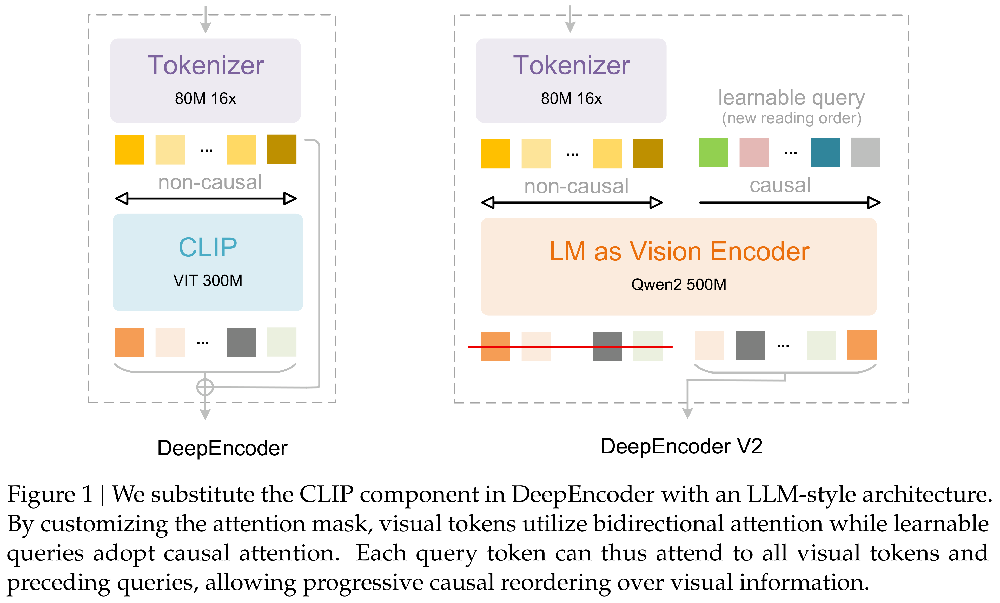
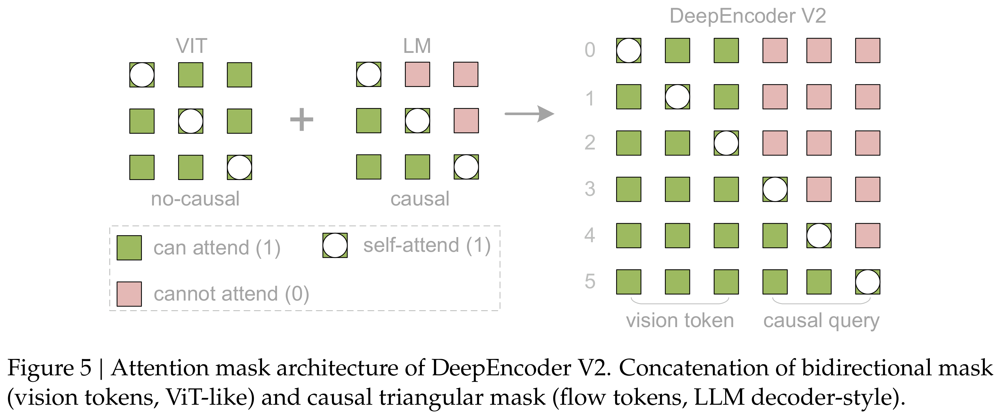

# DeepSeek-OCR 2: Visual Causal Flow

[中文](README_CN.md) · [Core figures](../../README.md)

[Original PDF](../../../pdfs/deepseek/technical-reports/deepseek-ocr-2-visual-causal-flow--arxiv-v1.pdf) · [Official source](https://github.com/deepseek-ai/DeepSeek-OCR-2)

## Overview · Figure 1

Source page: 1 · [PNG](figure-01.png) · [PDF with original graphics](figure-01.pdf)

[View source page](../../../pdfs/deepseek/technical-reports/deepseek-ocr-2-visual-causal-flow--arxiv-v1.pdf#page=1)

Figure 1 | We substitute the CLIP component in DeepEncoder with an LLM-style architecture.
By customizing the attention mask, visual tokens utilize bidirectional attention while learnable
queries adopt causal attention. Each query token can thus attend to all visual tokens and
preceding queries, allowing progressive causal reordering over visual information.

## Architecture · Figure 5

Source page: 7 · [PNG](figure-02.png) · [PDF with original graphics](figure-02.pdf)

[View source page](../../../pdfs/deepseek/technical-reports/deepseek-ocr-2-visual-causal-flow--arxiv-v1.pdf#page=7)

Figure 5 | Attention mask architecture of DeepEncoder V2. Concatenation of bidirectional mask
(vision tokens, ViT-like) and causal triangular mask (flow tokens, LLM decoder-style).
