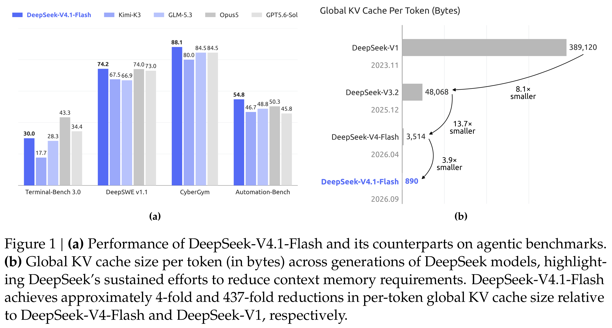
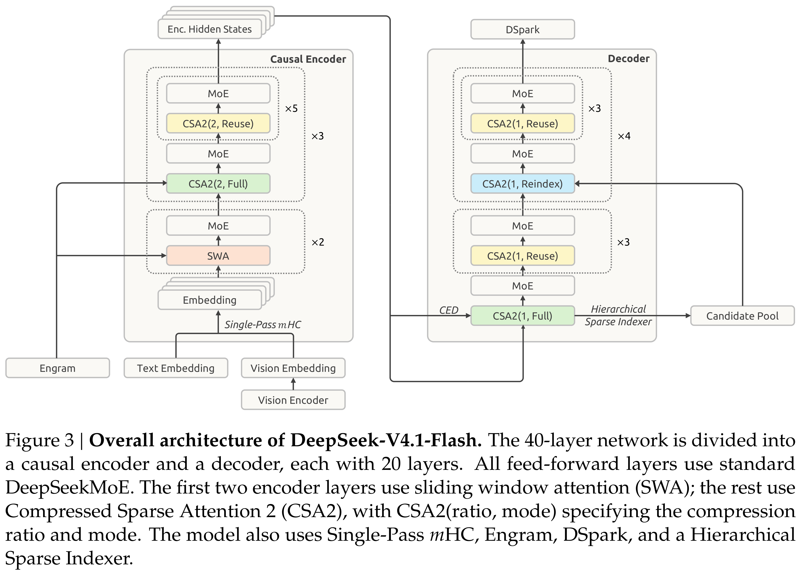

# DeepSeek-V4.1-Flash: Pushing the Limits of KV Cache Compression

[English](README.md) · [核心图片](../../README_CN.md)

[原始 PDF](../../../pdfs/deepseek/technical-reports/deepseek-v4-1-flash-technical-report--arxiv-v1.pdf) · [官方来源](https://arxiv.org/abs/2609.19969)

## 主要结果 · Figure 1

原文第1页 · [PNG](figure-01.png) · [保留原始图形的 PDF](figure-01.pdf)

[查看原页](../../../pdfs/deepseek/technical-reports/deepseek-v4-1-flash-technical-report--arxiv-v1.pdf#page=1)

Figure 1 | (a) Performance of DeepSeek-V4.1-Flash and its counterparts on agentic benchmarks.
(b) Global KV cache size per token (in bytes) across generations of DeepSeek models, highlight-
ing DeepSeek’s sustained efforts to reduce context memory requirements. DeepSeek-V4.1-Flash
achieves approximately 4-fold and 437-fold reductions in per-token global KV cache size relative
to DeepSeek-V4-Flash and DeepSeek-V1, respectively.

## 架构 · Figure 3

原文第7页 · [PNG](figure-02.png) · [保留原始图形的 PDF](figure-02.pdf)

[查看原页](../../../pdfs/deepseek/technical-reports/deepseek-v4-1-flash-technical-report--arxiv-v1.pdf#page=7)

Figure 3 | Overall architecture of DeepSeek-V4.1-Flash. The 40-layer network is divided into
a causal encoder and a decoder, each with 20 layers. All feed-forward layers use standard
DeepSeekMoE. The first two encoder layers use sliding window attention (SWA); the rest use
Compressed Sparse Attention 2 (CSA2), with CSA2(ratio, mode) specifying the compression
ratio and mode. The model also uses Single-Pass mHC, Engram, DSpark, and a Hierarchical
Sparse Indexer.
