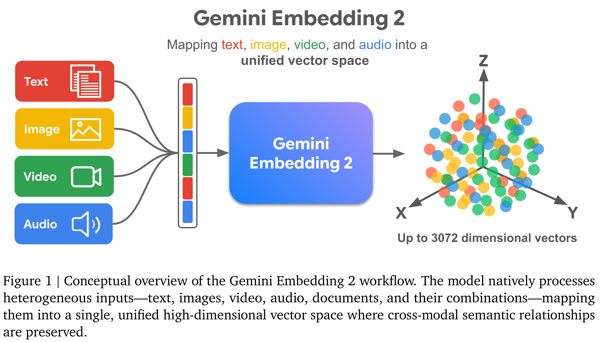
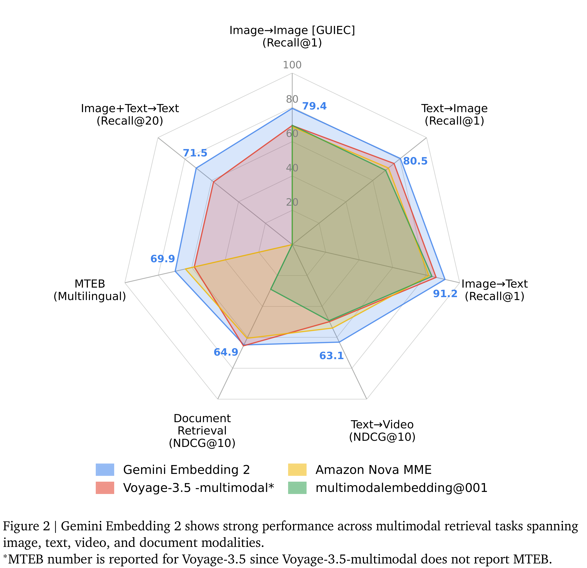

# Gemini Embedding 2: A Native Multimodal Embedding Model from Gemini

[中文](README_CN.md) · [Core figures](../../README.md)

[Original PDF](../../../pdfs/google/technical-reports/gemini-embedding-2--arxiv-v1.pdf) · [Official source](https://arxiv.org/abs/2605.27295)

## Architecture · Figure 1

Source page: 2 · [PNG](figure-01.png) · [PDF with original graphics](figure-01.pdf)

[View source page](../../../pdfs/google/technical-reports/gemini-embedding-2--arxiv-v1.pdf#page=2)

Figure 1 | Conceptual overview of the Gemini Embedding 2 workflow. The model natively processes
heterogeneous inputs—text, images, video, audio, documents, and their combinations—mapping
them into a single, unified high-dimensional vector space where cross-modal semantic relationships
are preserved.

## Results · Figure 2

Source page: 3 · [PNG](figure-02.png) · [PDF with original graphics](figure-02.pdf)

[View source page](../../../pdfs/google/technical-reports/gemini-embedding-2--arxiv-v1.pdf#page=3)

Figure 2 | Gemini Embedding 2 shows strong performance across multimodal retrieval tasks spanning
image, text, video, and document modalities.
∗MTEB number is reported for Voyage-3.5 since Voyage-3.5-multimodal does not report MTEB.
