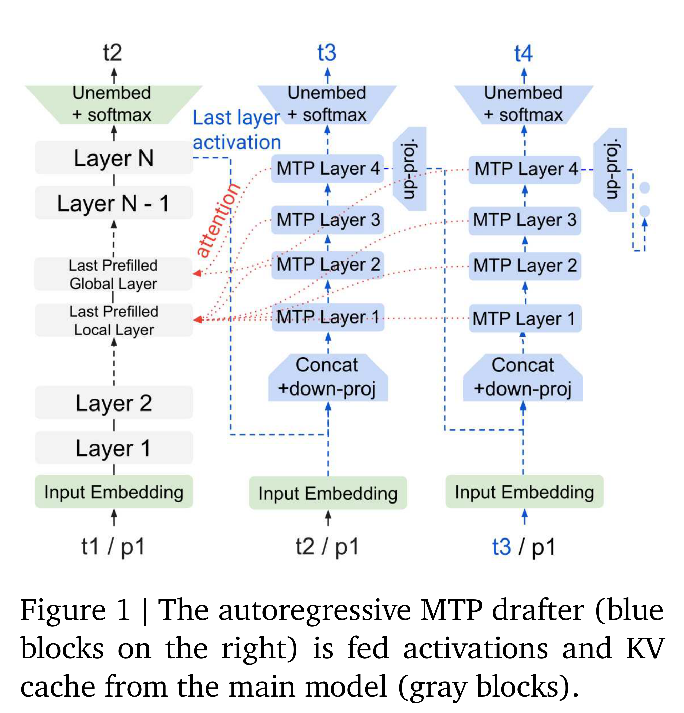

# Gemma 4 Technical Report

[中文](README_CN.md) · [Core figures](../../README.md)

[Original PDF](../../../pdfs/google/technical-reports/gemma-4-technical-report--arxiv-v2.pdf) · [Official source](https://arxiv.org/abs/2607.02770)

## Architecture · Figure 1

Source page: 3 · [PNG](figure-01.png) · [PDF with original graphics](figure-01.pdf)

[View source page](../../../pdfs/google/technical-reports/gemma-4-technical-report--arxiv-v2.pdf#page=3)

Figure 1 | The autoregressive MTP drafter (blue
blocks on the right) is fed activations and KV
cache from the main model (gray blocks).
