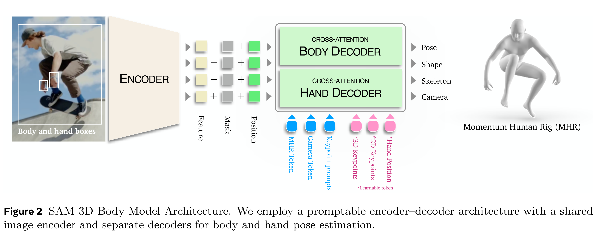
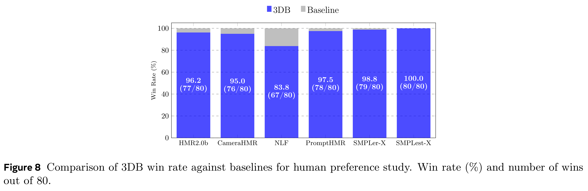

# SAM 3D Body: Robust Full-Body Human Mesh Recovery

[English](README.md) · [核心图片](../../README_CN.md)

[原始 PDF](../../../pdfs/meta/technical-reports/sam-3d-body-technical-report--arxiv-v1.pdf) · [官方来源](https://arxiv.org/abs/2602.15989)

## 架构 · Figure 2

原文第3页 · [PNG](figure-01.png) · [保留原始图形的 PDF](figure-01.pdf)

[查看原页](../../../pdfs/meta/technical-reports/sam-3d-body-technical-report--arxiv-v1.pdf#page=3)

Figure 2 SAM 3D Body Model Architecture. We employ a promptable encoder–decoder architecture with a shared
image encoder and separate decoders for body and hand pose estimation.

## 主要结果 · Figure 8

原文第13页 · [PNG](figure-02.png) · [保留原始图形的 PDF](figure-02.pdf)

[查看原页](../../../pdfs/meta/technical-reports/sam-3d-body-technical-report--arxiv-v1.pdf#page=13)

Figure 8 Comparison of 3DB win rate against baselines for human preference study. Win rate (%) and number of wins
out of 80.
