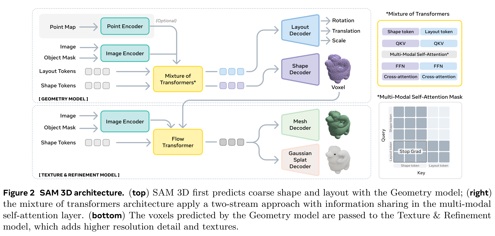
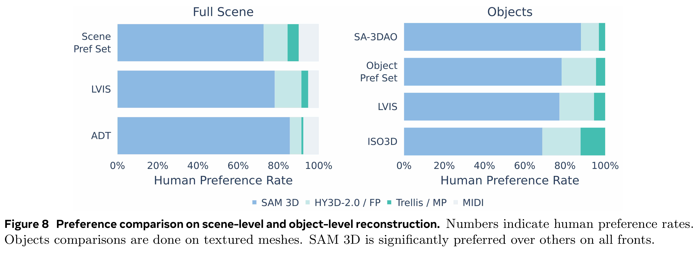

# SAM 3D: 3Dfy Anything in Images

[中文](README_CN.md) · [Core figures](../../README.md)

[Original PDF](../../../pdfs/meta/technical-reports/sam-3d-technical-report--arxiv-v2.pdf) · [Official source](https://arxiv.org/abs/2511.16624)

## Architecture · Figure 2

Source page: 3 · [PNG](figure-01.png) · [PDF with original graphics](figure-01.pdf)

[View source page](../../../pdfs/meta/technical-reports/sam-3d-technical-report--arxiv-v2.pdf#page=3)

Figure 2 SAM 3D architecture. (top) SAM 3D first predicts coarse shape and layout with the Geometry model; (right)
the mixture of transformers architecture apply a two-stream approach with information sharing in the multi-modal
self-attention layer. (bottom) The voxels predicted by the Geometry model are passed to the Texture & Refinement
model, which adds higher resolution detail and textures.

## Results · Figure 8

Source page: 10 · [PNG](figure-02.png) · [PDF with original graphics](figure-02.pdf)

[View source page](../../../pdfs/meta/technical-reports/sam-3d-technical-report--arxiv-v2.pdf#page=10)

Figure 8 Preference comparison on scene-level and object-level reconstruction. Numbers indicate human preference rates.
Objects comparisons are done on textured meshes. SAM 3D is significantly preferred over others on all fronts.
