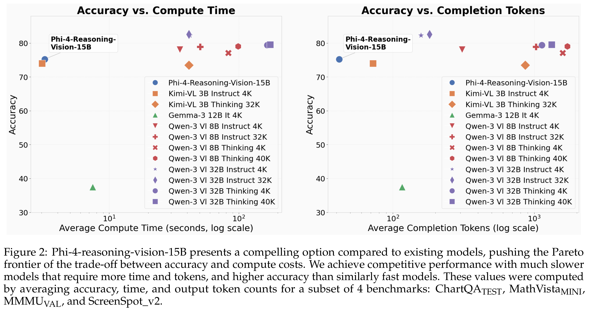
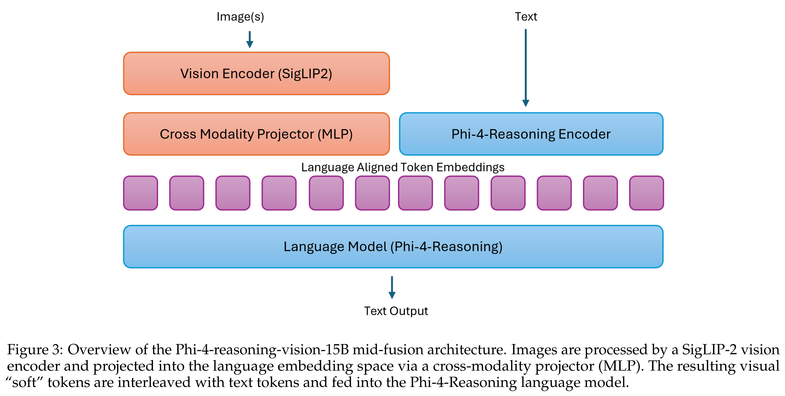

# Phi-4-reasoning-vision-15B Technical Report

[English](README.md) · [核心图片](../../README_CN.md)

[原始 PDF](../../../pdfs/microsoft/technical-reports/phi-4-reasoning-vision--arxiv-v1.pdf) · [官方来源](https://arxiv.org/abs/2603.03975)

## 主要结果 · Figure 2

原文第3页 · [PNG](figure-01.png) · [保留原始图形的 PDF](figure-01.pdf)

[查看原页](../../../pdfs/microsoft/technical-reports/phi-4-reasoning-vision--arxiv-v1.pdf#page=3)

Figure 2: Phi-4-reasoning-vision-15B presents a compelling option compared to existing models, pushing the Pareto
frontier of the trade-off between accuracy and compute costs. We achieve competitive performance with much slower
models that require more time and tokens, and higher accuracy than similarly fast models. These values were computed
by averaging accuracy, time, and output token counts for a subset of 4 benchmarks: ChartQATEST, MathVistaMINI,
MMMUVAL, and ScreenSpot_v2.

## 架构 · Figure 3

原文第4页 · [PNG](figure-02.png) · [保留原始图形的 PDF](figure-02.pdf)

[查看原页](../../../pdfs/microsoft/technical-reports/phi-4-reasoning-vision--arxiv-v1.pdf#page=4)

Figure 3: Overview of the Phi-4-reasoning-vision-15B mid-fusion architecture. Images are processed by a SigLIP-2 vision
encoder and projected into the language embedding space via a cross-modality projector (MLP). The resulting visual
“soft” tokens are interleaved with text tokens and fed into the Phi-4-Reasoning language model.
