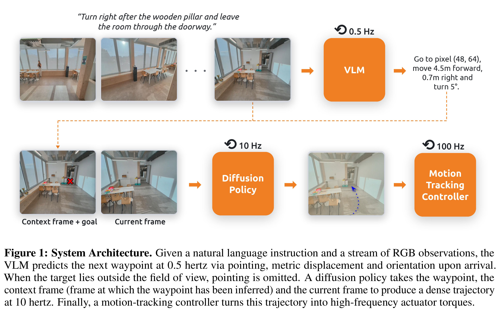
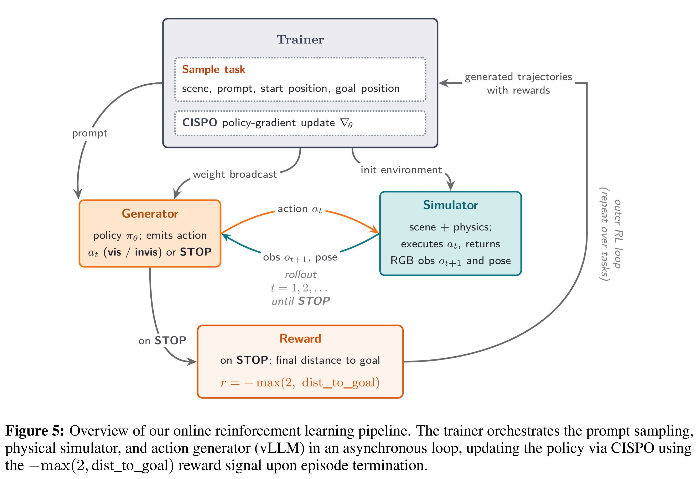

# Robostral Navigate

[中文](README_CN.md) · [Core figures](../../README.md)

[Original PDF](../../../pdfs/mistral/technical-reports/robostral-navigate--arxiv-v3.pdf) · [Official source](https://arxiv.org/abs/2607.20785)

## Architecture · Figure 1

Source page: 3 · [PNG](figure-01.png) · [PDF with original graphics](figure-01.pdf)

[View source page](../../../pdfs/mistral/technical-reports/robostral-navigate--arxiv-v3.pdf#page=3)

Figure 1: System Architecture. Given a natural language instruction and a stream of RGB observations, the
VLM predicts the next waypoint at 0.5 hertz via pointing, metric displacement and orientation upon arrival.
When the target lies outside the field of view, pointing is omitted. A diffusion policy takes the waypoint, the
context frame (frame at which the waypoint has been inferred) and the current frame to produce a dense trajectory
at 10 hertz. Finally, a motion-tracking controller turns this trajectory into high-frequency actuator torques.

## Architecture · Figure 5

Source page: 7 · [PNG](figure-02.png) · [PDF with original graphics](figure-02.pdf)

[View source page](../../../pdfs/mistral/technical-reports/robostral-navigate--arxiv-v3.pdf#page=7)

Figure 5: Overview of our online reinforcement learning pipeline. The trainer orchestrates the prompt sampling,
physical simulator, and action generator (vLLM) in an asynchronous loop, updating the policy via CISPO using
the −max(2, dist_to_goal) reward signal upon episode termination.
