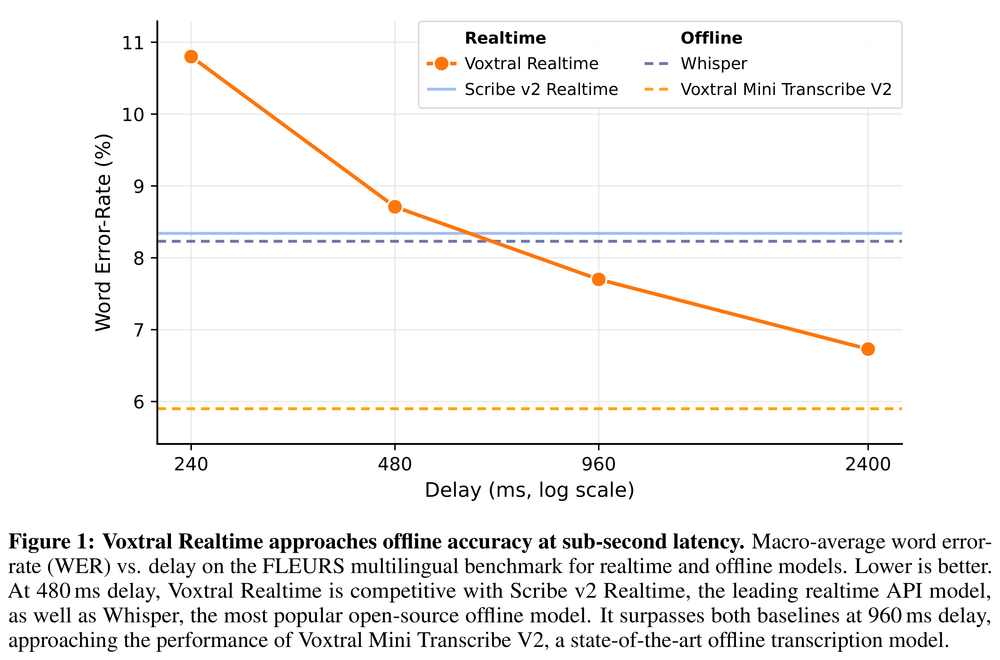
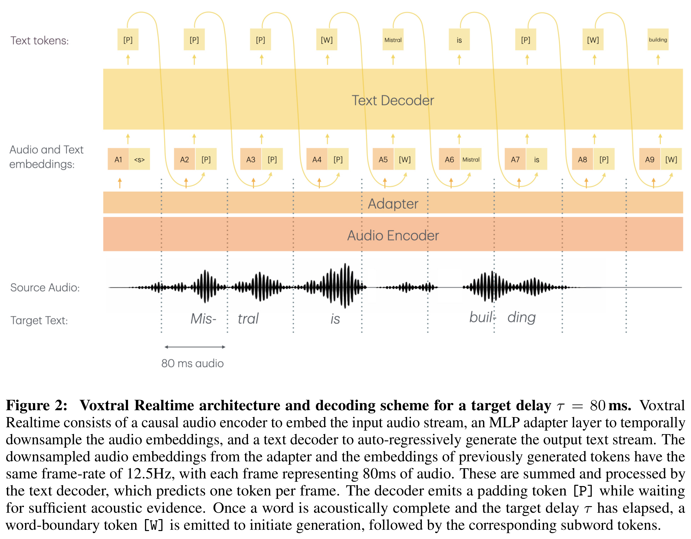

# Voxtral Realtime

[English](README.md) · [核心图片](../../README_CN.md)

[原始 PDF](../../../pdfs/mistral/technical-reports/voxtral-realtime--arxiv-v3.pdf) · [官方来源](https://arxiv.org/abs/2602.11298)

## 主要结果 · Figure 1

原文第1页 · [PNG](figure-01.png) · [保留原始图形的 PDF](figure-01.pdf)

[查看原页](../../../pdfs/mistral/technical-reports/voxtral-realtime--arxiv-v3.pdf#page=1)

Figure 1: Voxtral Realtime approaches offline accuracy at sub-second latency. Macro-average word error-
rate (WER) vs. delay on the FLEURS multilingual benchmark for realtime and offline models. Lower is better.
At 480 ms delay, Voxtral Realtime is competitive with Scribe v2 Realtime, the leading realtime API model,
as well as Whisper, the most popular open-source offline model. It surpasses both baselines at 960 ms delay,
approaching the performance of Voxtral Mini Transcribe V2, a state-of-the-art offline transcription model.

## 架构 · Figure 2

原文第3页 · [PNG](figure-02.png) · [保留原始图形的 PDF](figure-02.pdf)

[查看原页](../../../pdfs/mistral/technical-reports/voxtral-realtime--arxiv-v3.pdf#page=3)

Figure 2: Voxtral Realtime architecture and decoding scheme for a target delay τ = 80 ms. Voxtral
Realtime consists of a causal audio encoder to embed the input audio stream, an MLP adapter layer to temporally
downsample the audio embeddings, and a text decoder to auto-regressively generate the output text stream. The
downsampled audio embeddings from the adapter and the embeddings of previously generated tokens have the
same frame-rate of 12.5Hz, with each frame representing 80ms of audio. These are summed and processed by
the text decoder, which predicts one token per frame. The decoder emits a padding token [P] while waiting
for sufficient acoustic evidence. Once a word is acoustically complete and the target delay τ has elapsed, a
word-boundary token [W] is emitted to initiate generation, followed by the corresponding subword tokens.
