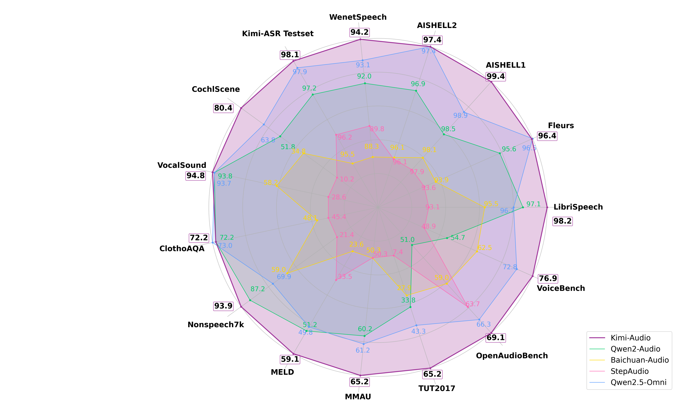
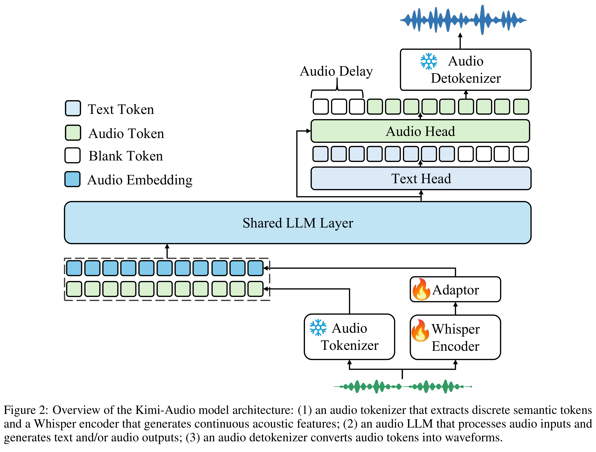

# Kimi-Audio Technical Report

[English](README.md) · [核心图片](../../README_CN.md)

[原始 PDF](../../../pdfs/moonshot/technical-reports/kimi-audio-technical-report--arxiv-v1.pdf) · [官方来源](https://github.com/MoonshotAI/Kimi-Audio)

## 主要结果 · Figure 1

原文第1页 · [PNG](figure-01.png) · [保留原始图形的 PDF](figure-01.pdf)

[查看原页](../../../pdfs/moonshot/technical-reports/kimi-audio-technical-report--arxiv-v1.pdf#page=1)

Figure 1: Performance of Kimi-Audio and previous audio langauge models including Qwen2-Audio [11], Baichuan-
Audio [41], Step-Audio [28], and Qwen2.5-Omni [73] on various benchmarks.

## 架构 · Figure 2

原文第4页 · [PNG](figure-02.png) · [保留原始图形的 PDF](figure-02.pdf)

[查看原页](../../../pdfs/moonshot/technical-reports/kimi-audio-technical-report--arxiv-v1.pdf#page=4)

Figure 2: Overview of the Kimi-Audio model architecture: (1) an audio tokenizer that extracts discrete semantic tokens
and a Whisper encoder that generates continuous acoustic features; (2) an audio LLM that processes audio inputs and
generates text and/or audio outputs; (3) an audio detokenizer converts audio tokens into waveforms.
