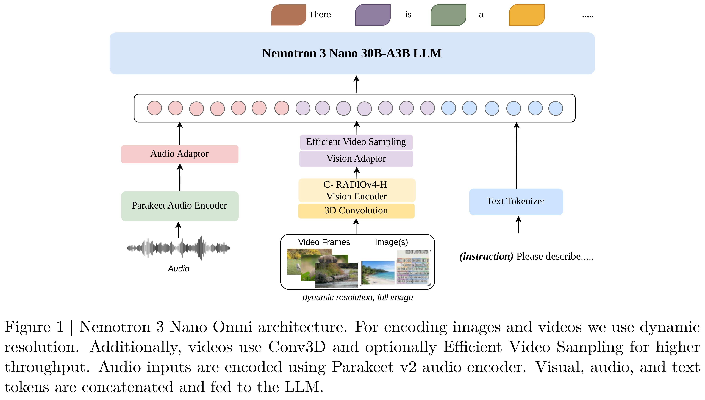
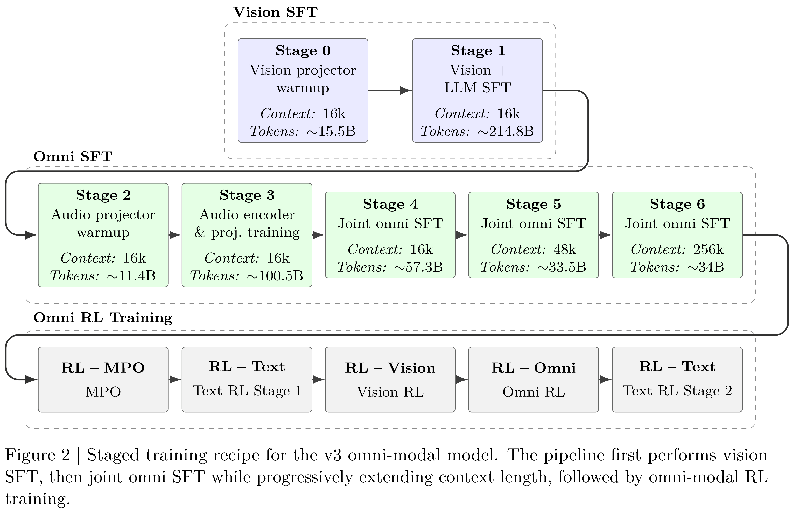

# Nemotron 3 Nano Omni: Efficient and Open Multimodal Intelligence

[English](README.md) · [核心图片](../../README_CN.md)

[原始 PDF](../../../pdfs/nvidia/technical-reports/nemotron-3-nano-omni--arxiv-v2.pdf) · [官方来源](https://arxiv.org/abs/2604.24954)

## 架构 · Figure 1

原文第3页 · [PNG](figure-01.png) · [保留原始图形的 PDF](figure-01.pdf)

[查看原页](../../../pdfs/nvidia/technical-reports/nemotron-3-nano-omni--arxiv-v2.pdf#page=3)

Figure 1 | Nemotron 3 Nano Omni architecture. For encoding images and videos we use dynamic
resolution. Additionally, videos use Conv3D and optionally Efficient Video Sampling for higher
throughput. Audio inputs are encoded using Parakeet v2 audio encoder. Visual, audio, and text
tokens are concatenated and fed to the LLM.

## 架构 · Figure 2

原文第4页 · [PNG](figure-02.png) · [保留原始图形的 PDF](figure-02.pdf)

[查看原页](../../../pdfs/nvidia/technical-reports/nemotron-3-nano-omni--arxiv-v2.pdf#page=4)

Figure 2 | Staged training recipe for the v3 omni-modal model. The pipeline first performs vision
SFT, then joint omni SFT while progressively extending context length, followed by omni-modal RL
training.
