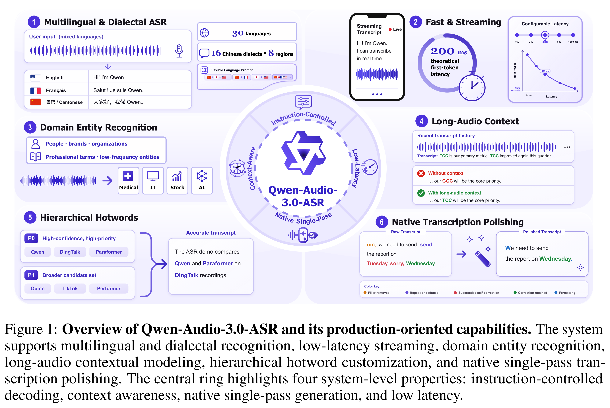
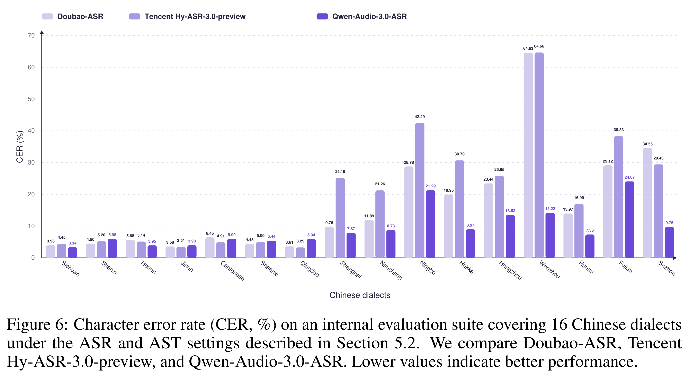

# Qwen-Audio-3.0-ASR Technical Report

[中文](README_CN.md) · [Core figures](../../README.md)

[Original PDF](../../../pdfs/qwen/technical-reports/qwen-audio-3-0-asr--arxiv-v2.pdf) · [Official source](https://arxiv.org/abs/2609.07549)

## Overview · Figure 1

Source page: 2 · [PNG](figure-01.png) · [PDF with original graphics](figure-01.pdf)

[View source page](../../../pdfs/qwen/technical-reports/qwen-audio-3-0-asr--arxiv-v2.pdf#page=2)

Figure 1: Overview of Qwen-Audio-3.0-ASR and its production-oriented capabilities. The system
supports multilingual and dialectal recognition, low-latency streaming, domain entity recognition,
long-audio contextual modeling, hierarchical hotword customization, and native single-pass tran-
scription polishing. The central ring highlights four system-level properties: instruction-controlled
decoding, context awareness, native single-pass generation, and low latency.

## Results · Figure 6

Source page: 14 · [PNG](figure-02.png) · [PDF with original graphics](figure-02.pdf)

[View source page](../../../pdfs/qwen/technical-reports/qwen-audio-3-0-asr--arxiv-v2.pdf#page=14)

Figure 6: Character error rate (CER, %) on an internal evaluation suite covering 16 Chinese dialects
under the ASR and AST settings described in Section 5.2. We compare Doubao-ASR, Tencent
Hy-ASR-3.0-preview, and Qwen-Audio-3.0-ASR. Lower values indicate better performance.
