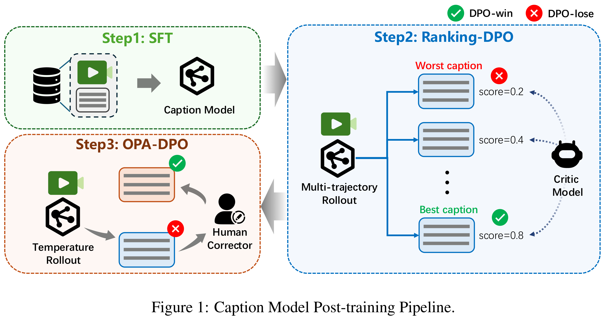
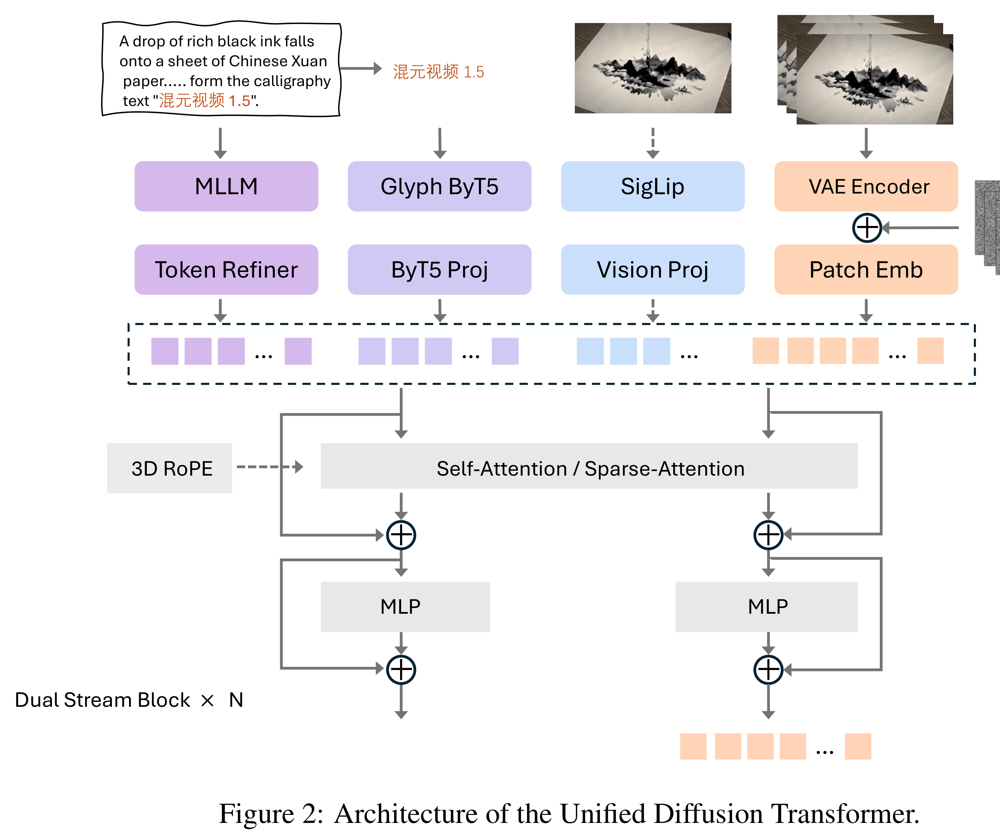

# HunyuanVideo 1.5 Technical Report

[English](README.md) · [核心图片](../../README_CN.md)

[原始 PDF](../../../pdfs/tencent/technical-reports/hunyuan-video-1-5--arxiv-v2.pdf) · [官方来源](https://github.com/Tencent-Hunyuan/HunyuanVideo-1.5)

## 架构 · Figure 1

原文第3页 · [PNG](figure-01.png) · [保留原始图形的 PDF](figure-01.pdf)

[查看原页](../../../pdfs/tencent/technical-reports/hunyuan-video-1-5--arxiv-v2.pdf#page=3)

Figure 1: Caption Model Post-training Pipeline.

## 架构 · Figure 2

原文第4页 · [PNG](figure-02.png) · [保留原始图形的 PDF](figure-02.pdf)

[查看原页](../../../pdfs/tencent/technical-reports/hunyuan-video-1-5--arxiv-v2.pdf#page=4)

Figure 2: Architecture of the Unified Diffusion Transformer.
